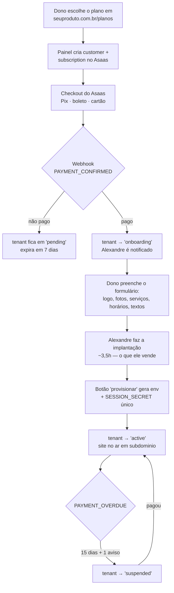
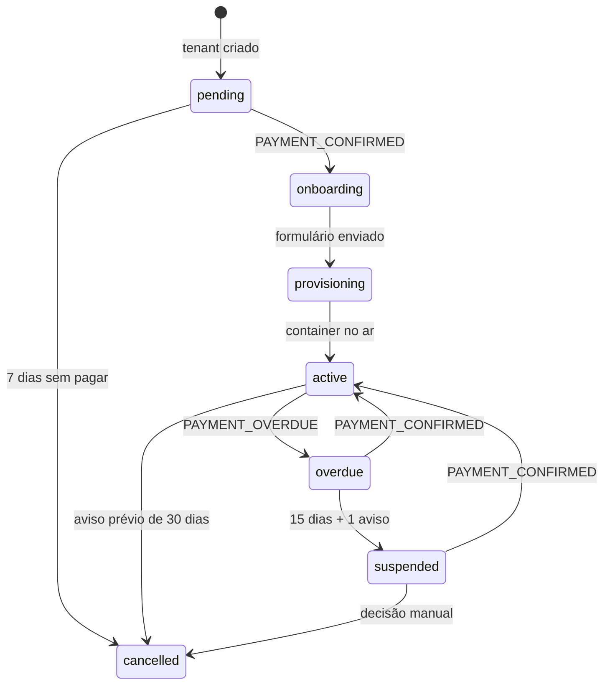

# Arquitetura — Cobrança recorrente e onboarding (V1)

> Especificação técnica. Data: 2026-08-28.
> Status: **especificado, não implementado.**
> Economia unitária e preços: `PRECIFICACAO.md`. Modelo de instância: `ARQUITETURA-PRODUTO-V1.md`.
> Decisão comercial: `PLANO-PRODUTIZACAO.md`.
>
> Todas as afirmações sobre o código atual foram verificadas arquivo por arquivo
> em 28/08/2026. Referências no formato `arquivo:linha` são literais.

---

## 1. O problema que este documento resolve

O pedido foi: *"que o software se comporte como SaaS — o cliente entra no site, escolhe o
plano mensal e consegue usar"*, mais personalização da landing de cada barbearia.

Isso são duas coisas com custos de ordem de grandeza diferente, e a confusão entre elas é o
risco principal:

| | O que é | Custo |
|---|---|---|
| **Comportamento comercial de SaaS** | Planos visíveis, checkout, cobrança que se repete sozinha, inadimplência tratada | ~55–75h |
| **Arquitetura self-service** | Cadastro público, provisionamento automático, trial, onboarding sem humano | ~230–370h |

Este documento especifica o **primeiro**, porque ele entrega a experiência que o cliente
percebe como SaaS e mantém a economia que sustenta o negócio (`PRECIFICACAO.md` §5): o setup
de R$ 2.500 é 54% da receita do ano 1, e ele só existe porque a implantação é assistida.

**Decisão central: checkout self-service, onboarding assistido.**

### 1.1 Por que não o self-service completo agora

Registrado para não ser rediscutido a cada três meses:

- **Sem setup, a economia inverte.** Quem se cadastra sozinho compara com AppBarber (R$ 79,90)
  e Booksy (R$ 99,99) e não paga R$ 180. A R$ 99 sem setup, a meta de R$ 2.500/mês sai de 15
  para 29 clientes — antes de contar churn.
- **Força a briga que a §4 do plano decidiu evitar.** Self-service *é* o modelo de commodity.
  Contra AppBarber, Trinks e Booksy, com um desenvolvedor meio período.
- **A primeira impressão vira o estado vazio.** No modelo assistido o dono só vê o site depois
  de cheio. No self-service, 100% dos clientes novos veem o site sem foto, sem serviço e sem
  texto — e decidem ali.
- **Multi-tenant sobre 46 endpoints e 7 arquivos de teste é risco de LGPD, não de bug.**
  Verificado: `src/pages/api/` tem 46 rotas, `tests/` tem 7 arquivos. O banco guarda nome,
  telefone e `customer_birthdate` (`schema.ts`, tabela `appointments`) dos clientes das
  barbearias. Hoje o isolamento é físico e sai de graça; multi-tenant troca isso por lógica
  de escopo sem rede de teste para segurá-la.

O que muda essa conclusão: alcance nacional com canal que gere entrada sozinho. Não existe hoje.

---

## 2. Princípio de arquitetura: dois aplicativos, não um

**A instância da barbearia nunca sabe que dinheiro existe.**

| | Aplicação | Responsabilidade |
|---|---|---|
| **App 1** | Este repositório, uma instância por barbearia | Site, agendamento, painel do barbeiro. Nada de cobrança. |
| **App 2** | **Painel de controle** — projeto novo, pequeno | Tenants, assinaturas, checkout, webhooks, provisionamento, suspensão. |

Três razões:

1. Preserva o princípio inegociável do `ARQUITETURA-PRODUTO-V1.md` §1 — uma base de código,
   uma imagem, N instâncias. Código de cobrança dentro da imagem faria toda barbearia carregar
   lógica de faturamento que só interessa a você.
2. **Se a cobrança quebrar, as barbearias continuam funcionando.** Um bug no webhook não pode
   tirar a agenda de sábado do ar.
3. O painel de controle é seu, roda num lugar só, e pode ser reescrito sem tocar em 15 volumes.

App 2 usa a mesma stack (Astro 6 SSR + `@astrojs/node` standalone + better-sqlite3 + Drizzle +
iron-session + Zod) — nada novo para aprender, e o `Dockerfile` atual serve de molde.

**Rejeitado:** tabela de assinatura dentro do banco da barbearia. Acopla produto a faturamento,
e o dono passaria a ter no volume dele dados sobre a sua operação comercial.

---

## 3. O fluxo



A venda porta a porta (`PLANO-PRODUTIZACAO.md` §11) entra no mesmo trilho: em vez do dono
abrir `/planos`, você cria o tenant no painel e manda o link de pagamento pelo WhatsApp. Um
fluxo só, duas portas de entrada.

### 3.1 O que o cliente vê entre pagar e o site ficar pronto

Esta é a parte que faz o modelo funcionar, e é a que um desenho ingênuo esquece.

Depois do pagamento confirmado, o dono cai numa página própria com: confirmação, prazo de
entrega prometido, e **o formulário de onboarding** — upload do logo, upload das fotos, lista
de serviços com preços, horário de funcionamento, textos, links de Instagram e Maps.

Isso resolve três problemas de uma vez:

- **O cliente percebe SaaS.** Ele escolheu, pagou e já está fazendo coisas. Não ficou esperando.
- **É o que torna as 3,5h possíveis.** Sem o formulário, a implantação começa por caçar
  informação no WhatsApp, e aí ela custa 8h — o cenário ruim da planilha.
- **É a semente do self-service.** Se um dia o self-service completo fizer sentido, este
  formulário vira o wizard. Construir agora não é trabalho jogado fora, é a Fase 0 dele.

---

## 4. Gateway: Asaas

Verificado em 28/08/2026.

| | Asaas | Stripe BR |
|---|---|---|
| Pix | **R$ 1,99 fixo** (R$ 0,99 nos 3 primeiros meses) | 1,19% — **só por convite** |
| Boleto | R$ 1,99 fixo | R$ 3,45 |
| Cartão à vista | R$ 0,49 + 1,99% (2,99% promocional) | 3,99% + R$ 0,39 |
| Assinaturas | Incluso | +0,7% do volume (Billing) |
| Mensalidade da conta | Nenhuma | Nenhuma |
| **Custo numa mensalidade de R$ 180** | **R$ 1,99 no Pix (1,1%)** | **R$ 8,83 no cartão (4,9%)** |

**Escolhido: Asaas.** Tarifa fixa em Pix e boleto é o que importa num ticket de R$ 180 — 1,1%
contra 4,9%. E o Pix da Stripe é liberado por convite, o que sozinho já o descarta para um
produto vendido a dono de barbearia no Brasil.

A 15 clientes pagando por Pix, o custo do gateway é **R$ 358/ano**. Irrelevante — mas escolher
a Stripe custaria R$ 1.590/ano, que é um VPS inteiro.

A API de assinaturas do Asaas suporta boleto, Pix e cartão, e emite webhooks por cobrança com
o campo `subscription` ligando à assinatura pai. Eventos que este desenho usa:

| Evento | Ação |
|---|---|
| `PAYMENT_CONFIRMED` | Pagamento processado. Libera o onboarding / reativa suspenso. |
| `PAYMENT_RECEIVED` | Valor disponível na conta. Só registra. |
| `PAYMENT_OVERDUE` | Marca `overdue_since`. Inicia a contagem dos 15 dias. |
| `PAYMENT_REFUNDED` / `PAYMENT_CHARGEBACK_REQUESTED` | Alerta manual. Nunca automatizar reembolso. |

> ⚠️ **Não deixar o cliente pagar a mensalidade com cartão parcelado.** As tarifas do Asaas sobem
> para 2,49%–3,29% em parcelamento, e assinatura parcelada não faz sentido. Fixar
> `billingType` em `PIX`, `BOLETO` ou `CREDIT_CARD` à vista.

---

## 5. Schema do painel de controle

Banco próprio, separado dos volumes das barbearias.

```sql
CREATE TABLE tenants (
  id                INTEGER PRIMARY KEY AUTOINCREMENT,
  slug              TEXT NOT NULL UNIQUE,   -- 'barbearia-x' → barbearia-x.seuproduto.com.br
  business_name     TEXT NOT NULL,
  owner_name        TEXT NOT NULL,
  owner_email       TEXT NOT NULL,
  owner_phone       TEXT NOT NULL,
  owner_document    TEXT NOT NULL,          -- CPF/CNPJ: o Asaas exige para criar o customer
  custom_domain     TEXT,                   -- null enquanto usar subdomínio
  status            TEXT NOT NULL DEFAULT 'pending',
  container_name    TEXT,
  data_volume       TEXT,
  provisioned_at    TEXT,
  notes             TEXT,
  created_at        TEXT NOT NULL DEFAULT (datetime('now'))
);

CREATE TABLE subscriptions (
  id                       INTEGER PRIMARY KEY AUTOINCREMENT,
  tenant_id                INTEGER NOT NULL REFERENCES tenants(id),
  gateway                  TEXT NOT NULL DEFAULT 'asaas',
  gateway_customer_id      TEXT NOT NULL,
  gateway_subscription_id  TEXT NOT NULL UNIQUE,
  status                   TEXT NOT NULL,   -- active | overdue | suspended | cancelled
  amount_cents             INTEGER NOT NULL,
  billing_type             TEXT NOT NULL,   -- PIX | BOLETO | CREDIT_CARD
  cycle                    TEXT NOT NULL DEFAULT 'MONTHLY',
  next_due_date            TEXT,
  overdue_since            TEXT,            -- base da contagem dos 15 dias
  created_at               TEXT NOT NULL DEFAULT (datetime('now'))
);

CREATE TABLE payments (
  id                  INTEGER PRIMARY KEY AUTOINCREMENT,
  tenant_id           INTEGER NOT NULL REFERENCES tenants(id),
  gateway_payment_id  TEXT NOT NULL UNIQUE,
  kind                TEXT NOT NULL,   -- setup | subscription
  status              TEXT NOT NULL,
  amount_cents        INTEGER NOT NULL,
  due_date            TEXT,
  paid_at             TEXT,
  created_at          TEXT NOT NULL DEFAULT (datetime('now'))
);

CREATE TABLE webhook_events (
  id                INTEGER PRIMARY KEY AUTOINCREMENT,
  gateway_event_id  TEXT NOT NULL UNIQUE,   -- idempotência: ver §5.1
  event             TEXT NOT NULL,
  payload           TEXT NOT NULL,          -- JSON cru, para auditoria
  received_at       TEXT NOT NULL DEFAULT (datetime('now')),
  processed_at      TEXT,
  error             TEXT
);

CREATE TABLE onboarding_submissions (
  id            INTEGER PRIMARY KEY AUTOINCREMENT,
  tenant_id     INTEGER NOT NULL REFERENCES tenants(id),
  payload       TEXT NOT NULL,   -- JSON: serviços, horários, textos, links
  files_path    TEXT,            -- pasta dos uploads do cliente
  submitted_at  TEXT
);
```

### 5.1 `webhook_events` não é luxo

O Asaas reenvia webhooks quando não recebe 200. Sem a `UNIQUE` em `gateway_event_id`, um reenvio
processa o mesmo pagamento duas vezes — o que no melhor caso duplica uma linha e no pior reativa
um tenant suspenso indevidamente. Gravar o evento cru primeiro, processar depois, marcar
`processed_at`. É o mesmo padrão da migration `0002_audit_and_idempotency` que já existe no
repositório para evitar duplo booking.

### 5.2 Estados do tenant



Os prazos (15 dias para suspender, 30 dias de aviso prévio para cancelar) **não são invenção
deste documento**: estão escritos na proposta que você já assinou como modelo,
`orcamentos/entrega-bayron-v5.docx`. O código deve seguir o contrato, não o contrário.

---

## 6. Endpoints do painel de controle

| Método | Rota | Auth | Descrição |
|---|---|---|---|
| `GET` | `/planos` | público | Página de planos e checkout |
| `POST` | `/api/checkout` | público + rate limit | Cria customer + subscription no Asaas, devolve link |
| `POST` | `/api/webhooks/asaas` | token no header | Recebe, grava e processa evento |
| `GET` | `/onboarding/[token]` | token do tenant | Formulário do dono |
| `POST` | `/api/onboarding/[token]` | token do tenant | Salva dados e uploads |
| `GET` | `/admin` | você | Lista de tenants, status, próximas cobranças |
| `POST` | `/api/admin/tenants` | você | Cria tenant na venda assistida |
| `POST` | `/api/admin/tenants/:id/provision` | você | Gera env + `SESSION_SECRET` único |
| `POST` | `/api/admin/tenants/:id/suspend` | você | Suspende (manual em V1 — ver §7.3) |

`POST /api/checkout` é público e cria registro no gateway — **precisa de rate limit**. O
repositório já tem `src/lib/rateLimit.ts` e `src/lib/clientIp.ts` funcionando; reusar o padrão.

---

## 7. Provisionamento e operação

### 7.1 `SESSION_SECRET` único por instância — o risco 🔴

`src/lib/session.ts` lê `process.env.SESSION_SECRET` e sela o cookie com iron-session. Se duas
barbearias compartilharem o secret, um cookie de admin emitido pela loja A é **criptograficamente
válido** na loja B.

Verificado, e vale registrar como atenuante: o cookie é emitido **sem atributo `Domain`**
(`session.ts`, `makeSessionCookie`), portanto é host-only — o navegador não envia o cookie de
`a.seuproduto.com.br` para `b.seuproduto.com.br` sozinho. O ataque exige copiar o cookie na mão.
Isso reduz a probabilidade, **não** a gravidade.

Regra: o botão de provisionar **gera** o secret, nunca copia.

```js
crypto.randomBytes(32).toString('hex')
```

Observação menor: `SESSION_COOKIE = '__bayron_session'` está fixo em `session.ts:3`. Não é falha
de segurança (cookies são host-only), mas o nome vai aparecer no DevTools de 15 clientes que não
se chamam Bayron. Renomear na Fase 1, junto com o resto da desmarcação.

### 7.2 O que o botão de provisionar faz na V1

Gera e mostra na tela o bloco de ambiente pronto para colar no EasyPanel:

```
SESSION_SECRET=<gerado agora, 64 hex>
DATABASE_PATH=/data/appointments.db
TZ=America/Fortaleza
SITE_URL=https://<slug>.seuproduto.com.br
ADMIN_INITIAL_PASSWORD=<gerado agora>
S3_BUCKET=... (credenciais de backup)
```

`scripts/startup.mjs` já aplica as migrations no boot do container, então subir a instância é
criar o serviço com essa imagem, esse volume e esse env. Nada de novo é necessário.

**Rejeitado para a V1: provisionar por API.** Chamar a API do EasyPanel ou o Docker por SSH
economiza uns 10 minutos por cliente e custa 15–20h para construir e manter, mais uma superfície
nova de falha. A 1 cliente por mês, o retorno chega depois do oitavo. Construir quando doer.

### 7.3 Suspensão: manual na V1

O painel detecta os 15 dias e **avisa você**. Você clica. Não automatize ainda:

- A 15 clientes, suspensão acontece talvez uma vez por mês.
- Suspender por engano tira a agenda de um negócio do ar num sábado. O custo de um falso
  positivo é desproporcional ao trabalho que a automação economiza.
- Suspender **não é parar o container** — é tirar o subdomínio da rota e servir uma página de
  "conta suspensa". Parar o container faz o site dar 502, que parece defeito seu, não
  inadimplência dele.

### 7.4 Subdomínio e SSL

Um registro DNS curinga `*.seuproduto.com.br → IP do VPS` mais o Traefik do EasyPanel emitindo
certificado por host sob demanda (HTTP-01). Zero trabalho por cliente novo e nenhuma API de DNS
para integrar.

Domínio próprio do cliente continua manual: registrar, apontar, adicionar o host. São ~15 minutos
dentro das 3,5h de implantação já cobradas, e é o item que mais reforça a venda
(`PLANO-PRODUTIZACAO.md` §4). Não vale automatizar.

---

## 8. Fora de escopo — e por quê

| Não construir | Motivo |
|---|---|
| Multi-tenant com `tenant_id` | §1.1. Revisar em 15–25 clientes, como já diz o plano §8. |
| Trial gratuito com instância viva | Cada curioso custa um container. Se houver trial, que seja sem instância. |
| Upgrade/downgrade de plano | Existe um plano. |
| Portal de faturas próprio | O Asaas já tem. Mandar o link. |
| Provisionamento por API | §7.2. |
| Suspensão automática | §7.3. |
| Cadastro sem intervenção humana | O produto entregue vazio é pior que produto nenhum. |

---

## 9. Custo em horas

Estimativa minha, a partir do tamanho medido do repositório (96 arquivos, ~13.900 linhas em
`src/`, 46 endpoints, 13 páginas de admin). Pode errar para os dois lados, não por um fator de 2.

| Bloco | Horas |
|---|---|
| **Fases 1–4 do `ARQUITETURA-PRODUTO-V1.md`** (settings, mídia, conteúdo, painel) — necessárias em qualquer cenário | **52–72** |
| Painel de controle: base, auth, CRUD de tenants | 12–16 |
| Integração Asaas: customer, subscription, link de pagamento | 8–12 |
| Webhook: recepção, idempotência, máquina de estados | 8–10 |
| Página pública de planos + checkout | 6–8 |
| Formulário de onboarding com upload | 10–14 |
| Botão de provisionar | 4–6 |
| Testes do fluxo de pagamento | 6–8 |
| **Subtotal painel de controle** | **54–74** |
| **Total do caminho do meio** | **106–146** |
| *Self-service completo, para comparação* | *~230–370* |

A 6h por semana, o caminho do meio é de 4 a 6 meses. Não é pequeno. É por isso que a §10 existe.

---

## 10. A ordem que eu defendo

O erro caro seria construir as 106–146h antes de saber se alguém compra. O painel de controle
só se paga a partir do 4º ou 5º cliente — para os três primeiros, **criar a assinatura à mão no
painel do Asaas resolve, com zero linha de código.**

1. **Fase 0 + Fases 1–2** (~30–40h) — corrigir o WhatsApp, tirar o `config.ts` do caminho, mídia
   em runtime. É o mínimo para existir um cliente nº 2 sem copiar o repositório.
2. **Vender 3 clientes** com assinatura criada na mão no Asaas. Cobrança recorrente funcionando,
   custo de desenvolvimento zero.
3. **Fases 3–4** (~28–38h) — conteúdo em tabelas e painel de configuração. Aqui a implantação
   passa a caber nas 3,5h que a precificação assume.
4. **Painel de controle** (~54–74h) — quando criar assinatura na mão começar a irritar, por volta
   do 4º ou 5º cliente.
5. Reavaliar self-service com 10 clientes e um formulário de onboarding preenchido 10 vezes. Aí
   você projeta o wizard a partir de dados, não de suposição.

O passo 2 é o único que produz informação nova. Os outros produzem código.

---

## 11. Pendências que este documento abre

| Item | Natureza |
|---|---|
| Nome do produto e domínio | ✅ Resolvidos em 30/08 e 01/09: **Barbearia no Ar**, com subdomínio nosso incluso e domínio próprio como opção paga. Ver `PENDENCIAS-ABERTAS.md` §0. **Falta registrar `barbearianoar.com.br`** — sem ele não há domínio pai para os subdomínios. |
| Conta PJ no Asaas | Exige CNPJ. Se você não tem, verificar se conta PF atende. |
| Emissão de nota fiscal | Não tratado neste desenho. Cobrar recorrente de 15 clientes tem consequência fiscal. |
| Termos de uso e política de privacidade | O checkout público precisa deles na tela. Ver `PENDENCIAS-ABERTAS.md` §1.2. |
| Cobertura de teste | **9 arquivos para 49 rotas** (recontado em 01/09; este documento dizia 7 para 46). Antes de atualizar N instâncias juntas — ver `PENDENCIAS-ABERTAS.md` §3.2 e o deploy em canário em `ARQUITETURA-PRODUCAO.md` §6 — é o maior risco operacional do produto. |
