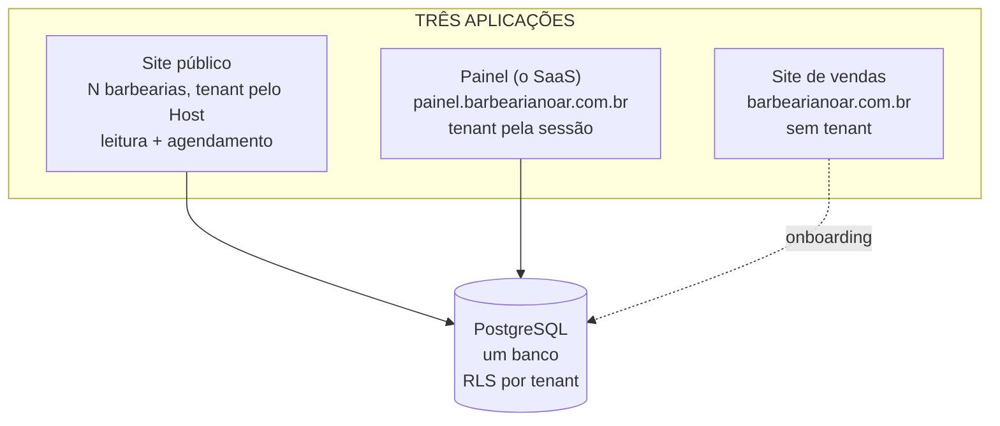

# Arquitetura — Multi-tenant com banco único (V1)

> Especificação da migração. Data: 2026-09-01. Revisado em 06/09/2026.
> Status: **passos 1 a 4 escritos e testados, NÃO aplicados.** Ver `ESTADO-ATUAL.md` §4.
>
> ⚠️ **Quatro coisas que este desenho não previa** apareceram ao implementar. Estão
> marcadas no texto e resumidas no §12.
> **Substitui a decisão D1 do `ARQUITETURA-PRODUTO-V1.md`**, que rejeitava multi-tenant.
> O §1 explica o que mudou; a D1 continua correta para o contexto em que foi escrita.
>
> Tudo que este documento afirma sobre o código atual foi verificado em 01/09/2026:
> **12 tabelas, 49 rotas, 9 arquivos de teste, 4 constraints `UNIQUE`.**

---

## 1. Por que agora, e o que isso não resolve

A D1 rejeitou multi-tenant com dois argumentos. Um caiu, o outro continua de pé.

**O que caiu — o momento.** A D1 dizia "revisar em 15–25 clientes". Mas o custo real
não é o número de clientes: é que migrar **dez negócios vivos** exige migração de dados,
janela de indisponibilidade e coordenação com dez donos. Hoje existem **zero clientes
pagantes**. A janela mais barata que vai existir é agora, e ela fecha na primeira venda.

**O que continua de pé — a economia.** Multi-tenant ataca a infraestrutura, que é **15%**
do custo por cliente. O suporte é **85%**. A 100 clientes, o banco único economiza
R$ 683/mês e o suporte custa 150 horas/mês. Ver `PRECIFICACAO.md` §5.

> **Entre nisto esperando um deploy em vez de dez, não esperando margem.** As alavancas
> de margem continuam sendo o medidor de completude e a política de suporte.

## 2. O desenho

Três aplicações, um banco.



**Por que o site é separado do painel**, e não um app só roteado por host:

- O site nunca pode cair; o painel pode. Deploy no painel não derruba o agendamento
  dos clientes de dez barbearias.
- O app público **não carrega código de administração nenhum** — menos superfície.
- Dá para cachear o site agressivamente sem afetar o painel.

Custo: dois deploys em vez de um. Continua sendo dois em vez de dez.

**Por que Postgres e não SQLite:** dois processos gravando o mesmo arquivo SQLite exige
que os dois containers vivam no mesmo host para sempre — o que mata metade do motivo de
separar. E, principalmente, o §4.

O Postgres **já roda na VPS**, ao lado do n8n e do redis (`PENDENCIAS-ABERTAS.md` §3.1).

## 3. Resolução do tenant

| App | Como descobre de quem é a requisição |
|---|---|
| Site público | Header `Host` → `SELECT * FROM tenants WHERE domain = $1 OR slug = $2` |
| Painel | `tenant_id` gravado na sessão no login |
| Site de vendas | Não tem tenant |

Um único módulo resolve isso nos dois apps. **É a costura que não pode estar espalhada.**

> ⚠️ No painel, o `tenant_id` da sessão precisa ser revalidado a cada requisição contra
> o estado do tenant (suspenso, cancelado). Sessão viva de tenant suspenso é o caminho
> mais fácil para um inadimplente continuar usando.

## 4. RLS — o que devolve a parede

Este é o principal motivo de escolher Postgres, e o que responde à objeção original.

Com instância por cliente, o isolamento era **físico**: arquivos diferentes no disco.
Multi-tenant, na forma ingênua, troca isso por **disciplina**: uma cláusula `WHERE`
esquecida em qualquer das 49 rotas vaza a lista de clientes de uma barbearia para outra
— com nome, telefone e data de nascimento.

Com **Row-Level Security** o banco passa a recusar sozinho:

```sql
ALTER TABLE appointments ENABLE ROW LEVEL SECURITY;

CREATE POLICY tenant_isolation ON appointments
  USING (tenant_id = current_setting('app.tenant_id')::int);
```

A aplicação faz `SET LOCAL app.tenant_id = $1` no início de cada transação. A partir daí,
**uma consulta que esqueceu o filtro devolve zero linhas em vez de vazar.** O erro vira
um bug visível em vez de um incidente silencioso de LGPD.

Isso não dispensa filtrar na aplicação — é a segunda parede, não a única.

## 5. Schema

### 5.1 Tabela nova

```sql
CREATE TABLE tenants (
  id           serial PRIMARY KEY,
  slug         text NOT NULL UNIQUE,     -- barbeariax.barbearianoar.com.br
  domain       text UNIQUE,              -- domínio próprio, quando houver
  business_name text NOT NULL,
  status       text NOT NULL DEFAULT 'active',  -- active | suspended | cancelled
  created_at   timestamptz NOT NULL DEFAULT now()
);
```

### 5.2 As 12 tabelas ganham `tenant_id`

`barbers`, `services`, `barber_services`, `working_hours`, `time_off`, `appointments`,
`appointment_items`, `product_sales`, `products`, `combos`, `reservations`, `settings`.

Todas com `tenant_id integer NOT NULL REFERENCES tenants(id)` e índice.

### 5.2.1 🔴 As chaves estrangeiras também precisam do tenant — não previsto

Dar `tenant_id` às tabelas **não basta**. Verificado em 06/09/2026: as **16 chaves
estrangeiras** do schema apontavam só para `id`, então nada impedia um agendamento do
tenant 1 apontar para um barbeiro do tenant 2.

**O RLS não pega isso.** Ele filtra pelo `tenant_id` da própria linha — que está certo. O
que está errado é para quem ela aponta: o dono do tenant 1 veria o agendamento (é dele) e,
ao juntar com `barbers`, leria o nome do barbeiro do tenant 2.

A correção é chave composta, com `UNIQUE (id, tenant_id)` em cada tabela referenciada:

```sql
FOREIGN KEY (barber_id, tenant_id) REFERENCES barbers (id, tenant_id)
```

Assim o banco recusa sozinho, sem depender de o código lembrar. Está na migration
`0001_tenants.sql`, em `migracao-tenants/`.

### 5.2.2 `settings.id` não tinha sequência — não previsto

No SQLite `settings` era a linha fixa `id = 1`, então a coluna nasceu `integer NOT NULL`
sem default. Com uma linha por tenant, o INSERT do segundo tenant falha com `null value in
column "id"`. Verificado em 06/09 — era exatamente esse o erro. A migration cria a
sequência.

### 5.3 ⚠️ As constraints `UNIQUE` que quebram — verificado

| Coluna | Hoje | Com tenants |
|---|---|---|
| `barbers.slug` | única global | **quebra** — duas lojas podem ter um "bayron". Vira `UNIQUE (tenant_id, slug)` |
| `services.slug` | única global | **quebra** — "corte-social" existe em toda barbearia. Vira `UNIQUE (tenant_id, slug)` |
| `products.slug` | única global | **quebra**. Vira `UNIQUE (tenant_id, slug)` |
| `appointments.manage_token` | única global | **mantém global** — é o token anônimo do link `/a/{token}`, e ele precisa ser único no mundo |

### 5.4 `settings` deixa de ser linha única

Hoje o código busca `where(eq(settings.id, 1))` em pelo menos quatro lugares (a rota
`api/admin/settings.ts`, a tela `admin/configuracoes.astro` e o `lib/settings.ts`).
Passa a ser **uma linha por tenant**, e o cache de módulo do `getSettings()` vira um
mapa por tenant.

## 6. O login quebra — e precisa de decisão

`barbers.slug` é, ao mesmo tempo, **a chave de login e uma constraint única global**.
Com vários tenants, dois donos chamados "bayron" colidem.

Três saídas:

1. **Login por e-mail** — globalmente único, resolve sozinho. O `owner_email` já existe
   no desenho de `tenants` do `ARQUITETURA-COBRANCA-V1.md` §5.
2. **Login por telefone** — todo barbeiro tem, é único, e é consistente com o portal do
   cliente, que já entra com telefone. Provavelmente melhor para este público que e-mail.
3. **Tenant primeiro, depois slug** — mantém a UX atual mas exige o barbeiro saber o
   endereço da própria barbearia. Contradiz a simplificação do §8.

**Decisão em aberto.** Recomendação: telefone.

## 7. Duplo agendamento fica mais forte, não mais fraco

Hoje `src/lib/bookAppointment.ts` usa `BEGIN IMMEDIATE`, re-checa conflito e insere —
uma trava de escrita do SQLite inteiro segurando a corrida.

No Postgres dá para o banco **tornar a sobreposição impossível**:

```sql
ALTER TABLE appointments ADD CONSTRAINT sem_sobreposicao
  EXCLUDE USING gist (
    barber_id WITH =,
    tstzrange(starts_at, ends_at) WITH &&
  ) WHERE (status IN ('confirmed','completed'));
```

Isso é estritamente melhor: a garantia sai da aplicação e vira invariante do banco. A
chave de idempotência continua necessária, para o clique duplo devolver o mesmo
agendamento em vez de um erro.

## 8. Consequências fora do banco

**Um `SESSION_SECRET` só.** O risco 🔴 de secret repetido entre instâncias
(`ARQUITETURA-PRODUCAO.md` §3) **deixa de existir** — há um app e uma sessão. Em troca,
nasce a obrigação do §3: validar o tenant da sessão a cada requisição.

**A tela `/acessar` simplifica.** Ela existe porque cada barbearia tinha um painel em
endereço próprio. Com painel central, o barbeiro vai sempre para
`painel.barbearianoar.com.br` e o login descobre a barbearia. A página vira um
redirecionamento — ou some.

**Deploy: de dez para dois.** É o ganho que motivou tudo.

**Uploads:** `uploads/{tenant_slug}/...`, com o caminho derivado de uma função só e a
rota de mídia conferindo o tenant antes de servir.

## 9. Ordem de execução

Cada passo termina com o sistema funcionando.

1. **As três costuras** — centralizar `getSettings()`, criar o resolvedor de tenant
   (devolvendo o tenant único por enquanto), derivar o caminho de uploads. Ainda em
   SQLite, ainda instância única. É reversível e vale por si.
2. **Porta para Postgres** — mesmo schema, sem tenants ainda. Trocar `better-sqlite3`
   por `postgres-js` no Drizzle, portar o `BEGIN IMMEDIATE` do §7. Rodar os 9 testes.
3. **Introduzir `tenants` e `tenant_id`** — migration, uniques compostas, backfill de um
   tenant único com os dados atuais.
4. **Escopar as rotas** — uma a uma, com teste de escopo em cada.

   ⚠️ **Não são 49, e não são só rotas.** Verificado em 06/09/2026: são **41 rotas de API
   que tocam o banco** mais **12 páginas `.astro`** que consultam direto no frontmatter —
   o painel inteiro. Total: 54. As páginas nunca entraram na conta deste documento.

   ⚠️ **O compilador só vê os INSERT.** Depois do passo 3, `tsc` aponta os INSERT sem
   `tenant_id` — útil, mas é a ponta. Os `SELECT` sem filtro ele não vê, e são eles que
   vazam. Um deles, `admin/reservations/index.ts`, não tinha `.where()` nenhum.
5. **Ligar RLS** — a rede que pega o que escapou do passo 4.
6. **Separar os dois apps** — extrair o site público do painel.
7. **Login por telefone** (§6) e a exclusion constraint (§7).

> ⚠️ Os passos 4 e 5 na ordem inversa dariam falsa segurança: com RLS ligado antes, uma
> consulta sem filtro devolve zero linhas silenciosamente e passa despercebida no
> desenvolvimento.

## 10. Riscos

**🔴 Cobertura de teste.** 9 arquivos para 49 rotas. O passo 4 é exatamente onde um
esquecimento vaza dados, e não há rede. **Escrever o teste de escopo junto com cada
rota, não depois.** O RLS reduz a gravidade, não dispensa o teste.

**🔴 A janela fecha na primeira venda.** Com cliente pagando, cada passo passa a exigir
janela de indisponibilidade. Se a migração não couber antes da primeira venda, é melhor
parar no passo 1 e retomar depois — o passo 1 é útil de qualquer forma.

**🟠 Raio de dano inverte.** Hoje o banco de uma barbearia corrompido afeta uma. Com
banco único, afeta todas. O backup deixa de ser por instância e vira um só — e o teste
de restauração, que já estava adiado, passa a ser mais importante, não menos.

**🟠 Postgres é mais um serviço a operar.** Já roda na VPS, mas hoje ninguém depende
dele para nada crítico. Passa a ser o ponto único de falha do produto inteiro.

## 11. O que muda nos outros documentos

| Documento | O que fica desatualizado |
|---|---|
| `ARQUITETURA-PRODUTO-V1.md` | **D1 inteira** (instância por cliente), D3.1 (cache de settings), e o gatilho de 15–25 clientes |
| `ARQUITETURA-PRODUCAO.md` | O desenho de N instâncias, o `SESSION_SECRET` por instância, o deploy em canário (deixa de ser N containers) |
| `ARQUITETURA-COBRANCA-V1.md` | §1.1 rejeitava multi-tenant por risco de LGPD — o RLS é a resposta que não existia; o provisionamento deixa de gerar container |
| `PENDENCIAS-ABERTAS.md` §3.2 | "Processo de atualizar N containers" passa a ser dois deploys |
| `PENDENCIAS-ABERTAS.md` §3.1 | "Onde as instâncias rodam" vira "onde os dois apps e o Postgres rodam" |

**Nenhum deles foi alterado ainda.** Alterar antes de implementar produz documento que
descreve um sistema que não existe — o problema que este projeto já teve uma vez.

---

## 12. O que a implementação revelou — 06/09/2026

Escrito depois de implementar os passos 3, 3.5 e 4 e rodar contra um PostgreSQL 16.13
real. Cada item aqui é uma correção deste documento, não uma observação.

| O que o documento dizia | O que se descobriu |
|---|---|
| §5.2: dar `tenant_id` às 12 tabelas | Não basta. As **16 chaves estrangeiras** também precisam — §5.2.1 |
| §9 passo 4: "escopar as 49 rotas" | São **41 rotas + 12 páginas `.astro`** = 54 — §9 |
| §5.4: `settings` vira uma linha por tenant | E o `id` precisa de sequência, que não existia — §5.2.2 |
| §9 passo 1: "as três costuras" | A terceira (`pastaDeMidia`/`urlDeMidia`) **nunca tinha sido escrita** |

### 12.1 A terceira costura não existia

O `CLAUDE.md` e o `ESTADO-ATUAL.md` afirmavam que `pastaDeMidia()` e `urlDeMidia()` eram
"os únicos lugares que montam caminho de mídia". Elas não existiam no código — só o
`tests/tenant.test.ts` as referenciava, e por isso aquele teste não compilava. Foram
escritas em 06/09.

A barbearia única mantém o caminho **sem** o slug de propósito: os arquivos já estão no
disco assim e os caminhos estão gravados no banco. Inserir o slug agora quebraria a
instância em produção.

### 12.2 As consultas por telefone eram o pior vazamento

Três rotas buscam o cliente por `customer_phone`, e **telefone não é escopado por
barbearia** — é a mesma pessoa nas duas:

- `admin/appointments/[id]/history.ts` monta a ficha do cliente. Sem filtro, o dono de uma
  barbearia via o histórico dele na barbearia do vizinho: agendamentos, serviços, gasto.
- `admin/appointments/[id]/customer.ts` fazia `UPDATE ... WHERE customer_phone = ?` — ou
  seja, **reescreveria** nome e data de nascimento do cliente na outra barbearia.
- `customer/login.ts` autentica por telefone + nascimento: sem tenant, o cliente entraria
  no portal da barbearia errada.

### 12.3 O escopo é inofensivo hoje; ligar o resolvedor não é

`tenantDoHost()` e `tenantDaSessao()` continuam devolvendo `TENANT_UNICO`. Os filtros
existem em 53 rotas e páginas, todos apontando para a mesma barbearia — **em produção nada
muda de comportamento.** Eles passam a valer no dia em que o resolvedor for ligado.

Foi de propósito: escopar sem ligar o resolvedor é reversível e não quebra nada; ligar o
resolvedor com rotas ainda sem escopo é o que vaza.

⚠️ `tests/tenant.test.ts` tem um teste que **deve falhar** quando o resolvedor for ligado.
Não o apague quando falhar — é o alarme de que os chamadores precisam passar host e sessão
de verdade.

### 12.4 A lição de processo

**Um erro de sintaxe faz o `tsc` parar de checar semântica.** Durante o passo 4 um script
quebrou um arquivo; o compilador passou a reportar só os 5 erros de sintaxe e escondeu 6
erros de variável fora de escopo. "Poucos erros" pode significar "a checagem parou".

Corolário para este projeto: comparar a contagem de erros com a **linha de base**, não com
zero. O `astro check` tem 282 erros pré-existentes; o que importa é que nenhum arquivo
piorou.

**Correção do corolário, 06/09/2026.** "Nenhum arquivo piorou" também não basta quando
o número é grande. `Services.astro` e `Products.astro` foram escritos com `getSettings()`
sem `await`; o `astro check` acusou
(`Property 'shortName' does not exist on type 'Promise<Settings>'`) e o total foi de 277
para 278 — **um erro no meio de 277 é invisível**. O bug só apareceu porque a página foi
servida contra dois bancos diferentes e o site do Bayron veio sem o próprio catálogo.

Duas conclusões, na ordem de valor:

1. **Rodar, não só compilar.** O tipo de erro que sobrevive à checagem estática é o que
   dá `undefined` em silêncio. Testar o caso "cliente novo" e o caso "Bayron" custou dois
   `curl` e pegou o que a checagem não pegou.
2. **Comparar o conjunto de erros, não a contagem.** Enquanto a linha de base não for
   zero, `diff` entre a lista antiga e a nova é a única leitura confiável — e derrubar
   esses 277 erros vale mais do que aprender a conviver com eles.
