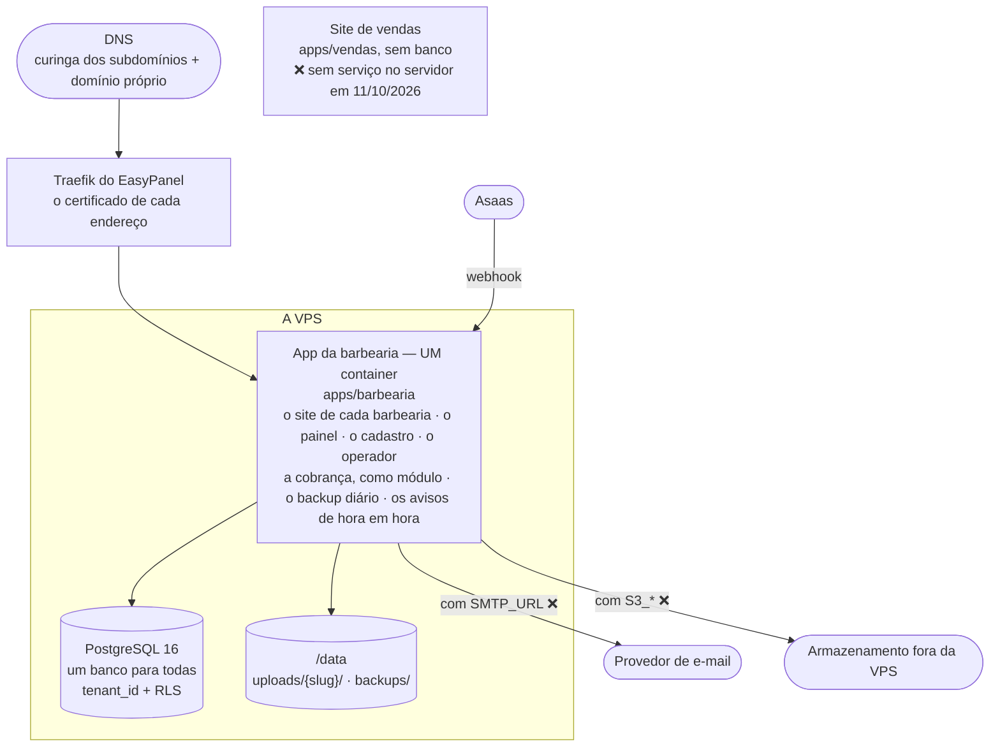
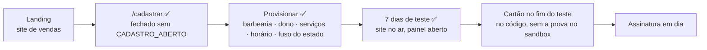

# Arquitetura de produção — como fica com N barbearias

> Data: 2026-09-01. **Reescrito em 2026-10-12.** Até aqui este documento descrevia o desenho
> de 01/09 — um container e um SQLite por barbearia —, que o multi-tenant reverteu
> (`ARQUITETURA-MULTI-TENANT-V1.md`), e continuava marcado como vigente. O desenho de 01/09
> está resumido no §10, com o que mudou em cada ponto; o texto inteiro, no histórico do git
> deste arquivo.
>
> Status: **descreve o desenho que roda.** Desde 10/10/2026 o app multi-tenant está no ar, construído
> da `main`, com o banco vazio; o site do Bayron continua no serviço antigo, de outro
> repositório, até a migração (`ROTEIRO-MIGRACAO-PRODUCAO.md`). O que não existe está marcado
> ❌; o que não foi medido, dito. ⚠️ **A `main` parou no merge do PR #1** (conferido no GitHub
> em 16/10): o que este documento diz do código de 10/10 à tarde para cá — a cobrança, o
> operador, a saúde, o backup em partes, o backup antes das migrations — está na `monorepo`, e
> não no ar (`PENDENCIAS-ABERTAS.md` §3.2).
>
> Companheiros nesta mesma pasta: `ARQUITETURA-MULTI-TENANT-V1.md` (como o sistema é
> montado), `ARQUITETURA-COBRANCA-V1.md` (o dinheiro), `PENDENCIAS-ABERTAS.md` §3 (o que falta
> decidir na operação). O estado do servidor — endereços, serviços, credenciais — não mora
> aqui: este repositório é público (`CLAUDE.md`).

---

## 1. O que este documento resolve

As peças da produção estão espalhadas em vários documentos e nenhum mostra o conjunto. Este
mostra: **o que roda onde, quando N barbearias estiverem pagando.**

## 2. O desenho

**Um app atende todas as barbearias.** O site de cada uma, o painel, o `/cadastrar` e o
`/operador` são o mesmo processo; quem decide de quem é cada requisição é um resolvedor só
(§4). Os dados de todas moram num Postgres, separados pelo `tenant_id` em toda tabela e pelo
RLS, a segunda parede: dentro da requisição o app fala com o banco como o papel
`barbearia_app`, com a barbearia da requisição gravada na conexão
(`apps/barbearia/src/db/index.ts`), e a conexão do dono das tabelas só é usada numa lista
fechada de arquivos (`apps/barbearia/tests/rls.test.ts`).

**A regra que sobrou do desenho antigo: se a cobrança quebrar, as barbearias continuam
funcionando.** Antes ela era garantida por dois aplicativos; desde 08/10/2026 a cobrança é um
módulo do app (`ARQUITETURA-COBRANCA-V1.md` §2), e a garantia vem de onde ele é usado: só pela
tela de assinatura, pelas rotas dela e pelo webhook da Asaas, que não é rota de barbearia — o
evento que falha volta para a fila da Asaas ou fica gravado com o erro, e nenhum site depende
dele (`apps/barbearia/src/pages/api/asaas/webhook.ts`).

⚠️ **O contrário vale:** a fase de cada barbearia só muda pelo webhook. Com o app fora do ar,
a Asaas tenta de novo e, com 15 falhas seguidas, interrompe a fila — e os avisos param até
alguém reativá-la, guardados por 14 dias. Enquanto isso, quem pagou continua com o prazo
correndo. Quem vê: o e-mail da Asaas, o monitor (D-P1) e, desde 17/10/2026, o Início e o
Sistema do painel do operador (`PENDENCIAS-ABERTAS.md` §3.13).

## 3. Anatomia do app

Um container da imagem (`apps/barbearia/Dockerfile`, com `apps/barbearia` como contexto do
build — `MONOREPO.md` §3), o volume `/data` e as variáveis. As que decidem alguma coisa:

| Variável | O que decide |
|---|---|
| `DATABASE_URL` | O banco. O usuário dono das tabelas — sem superusuário depois da troca (`PENDENCIAS-ABERTAS.md` §3.10) |
| `SESSION_SECRET` | **Um só para o app inteiro.** Trocar desloga todo mundo |
| `PAINEL_URL`, `DOMINIO_BASE` | O endereço do painel e o domínio dos subdomínios das barbearias |
| `TZ` | Só o relógio do container: a hora do backup. O fuso de cada barbearia é a coluna `tenants.timezone` (`PENDENCIAS-ABERTAS.md` §2.1) |
| `SMTP_URL` | O e-mail — a senha nova, os avisos do teste e da cobrança, o aviso de agenda |
| `ASAAS_*` | A cobrança. Sem a chave, desligada; sem `ASAAS_AMBIENTE=producao`, sandbox |
| `S3_*` | O backup para fora da VPS |
| `OPERADOR_SENHA_HASH` | O painel do operador. Sem ela, `/operador` responde 404 |
| `CADASTRO_ABERTO` | O cadastro pela web. Sem ela, `/cadastrar` responde 404 |

As cinco de baixo desligam a sua parte quando faltam, sem derrubar o resto — o e-mail
desligado, o boot avisa (`apps/barbearia/scripts/startup.mjs`).

**O `SESSION_SECRET` repetido entre instâncias, o risco 🔴 deste parágrafo em 01/09, deixou
de existir:** há um app e uma sessão (`ARQUITETURA-MULTI-TENANT-V1.md` §8). Em troca, a sessão
carrega a barbearia e é conferida a cada requisição — a barbearia no ar, o barbeiro ativo,
nela, com o papel de agora e sem senha trocada depois do login
(`apps/barbearia/src/lib/session.ts`).

**O que distingue a Barbearia A da B** é uma linha em `tenants` — o endereço (`slug` e
`domain`), o status, os prazos do teste e da cobrança, o fuso — e as linhas com o `tenant_id`
dela. As fotos ficam na pasta dela, `uploads/{slug}/`, e a rota de mídia confere de quem é o
arquivo antes de servir. Cor, logo, textos, serviços, horários: linha no banco, como já era.

O mesmo container roda, além do servidor, dois processos de fundo, lançados pelo `CMD` do
`Dockerfile`: o backup — um no boot e um por dia (`apps/barbearia/scripts/backup-daemon.mjs`)
— e os avisos por e-mail, de hora em hora (`apps/barbearia/scripts/avisos-daemon.mjs`).

**A ordem do `CMD` importa:** primeiro as migrations, depois o daemon do backup — e o backup
de boot dele é pulado se houver um com menos de 12 horas. Até 17/10/2026, então, uma migration
nova rodava sem backup nenhum logo antes dela. Desde então, o próprio boot faz o dump do banco
antes de aplicar migration pendente, e não migra sem ele (`backupAntesDasMigrations`, em
`apps/barbearia/scripts/startup.mjs`; `PENDENCIAS-ABERTAS.md` §3.2).

## 4. Roteamento e certificado

**De quem é a requisição** decide um módulo só, `apps/barbearia/src/lib/tenant.ts`: no painel,
a sessão; no site, o endereço — o domínio próprio da barbearia, ou o primeiro rótulo do
subdomínio do produto. Endereço que não é de barbearia nenhuma, ou de barbearia encerrada,
responde 404; o de barbearia fora do ar mostra o aviso com o WhatsApp dela.

~~Traefik do EasyPanel emitindo certificado por host sob demanda (HTTP-01).~~ **Corrigido em
09/10/2026:** o Traefik não emite certificado para qualquer endereço na hora, e o certificado
curinga dos subdomínios só sai pelo desafio DNS-01 — com o DNS num provedor que ele suporte, e
o registro.br não é um deles. O caminho é o DNS na Cloudflare (`ARQUITETURA-COBRANCA-V1.md`
§7.4). Para o domínio próprio do cliente, o certificado por endereço continua valendo: ali o
endereço é escrito à mão.

*10/10/2026: em produção, o certificado do painel saiu exatamente assim — por endereço, ao
adicioná-lo no EasyPanel. Não desmente o parágrafo acima: o curinga dos subdomínios continua
dependendo do DNS-01. E o domínio pai, por ora, é um domínio pessoal do dono, provisório
(`PENDENCIAS-ABERTAS.md` §2.31).*

- **Subdomínio nosso** — um registro DNS curinga aponta para o IP do VPS, e o resolvedor acha
  a barbearia pelo endereço. Com o certificado curinga, cliente novo não dá trabalho nenhum;
  sem ele, o site que nasce no cadastro não abre com cadeado (`PENDENCIAS-ABERTAS.md` §2.31).
- **Domínio próprio do cliente** — registrar, apontar, adicionar o host no EasyPanel e gravar
  em `tenants.domain`. Manual, de propósito: é o que mais reforça a venda, e não vale
  automatizar.

~~A escolha entre os dois **ainda está aberta**~~ — decidida em 01/09/2026: subdomínio nosso
incluso, domínio próprio como opção paga pelo cliente (`PENDENCIAS-ABERTAS.md` §1.1 e
`PRECIFICACAO.md` §6).

## 5. Como uma barbearia nova entra

Ninguém monta nada: o dono se cadastra sozinho (decisão de 24/09/2026,
`PLANO-PRODUTIZACAO.md` §13), e o cadastro cria a barbearia numa transação só, pela mesma
função do script de suporte (`apps/barbearia/src/lib/provisionarBarbearia.ts` e
`apps/barbearia/scripts/provisionar.mts`). O caminho do dono, tela a tela, está no
`JORNADA-DO-BARBEIRO.md`. **O cadastro não abre no ar de hoje**, pelos motivos do
`PENDENCIAS-ABERTAS.md` §2.31.

## 6. Decisões desta camada

### D-P1 — Endpoint de saúde ✅ feito em 11/10/2026

`GET /api/saude` responde `{"ok":true}`, ou 503 quando o banco falha ou demora mais de 3 s
(`apps/barbearia/src/lib/saude.ts`). Ficou de fora o que o desenho de 01/09 pedia — a versão da
imagem e a contagem de migrations —, porque as perguntas que elas respondiam mudaram: com um
container só, as barbearias estão sempre na mesma versão, e o boot não deixa o servidor subir
com uma migration falhando. Ela não vê o certificado nem o endereço de cada barbearia: o
monitor chama também o site de uma delas. O monitor é seu (`PENDENCIAS-ABERTAS.md` §3.4).

### D-P2 — Deploy em canário: o problema mudou de forma 🟠

Em 01/09 o canário era subir a versão nova numa barbearia de demonstração, depois num cliente,
depois no resto. Com um container para todas, não existe "uma barbearia primeiro": **o deploy
é um só, e um deploy ruim derruba todas de uma vez.** O que segura hoje é antes do deploy — a
suíte com banco no CI, que ainda não manda no deploy (`PENDENCIAS-ABERTAS.md` §3.8), e cada
migration conferida sobre um banco parado na anterior (`PENDENCIAS-ABERTAS.md` §3.2) — e, desde
17/10/2026, o backup que o boot faz antes de aplicar migration nova, sem o qual ele não migra:
voltar atrás é a imagem anterior com esse arquivo restaurado.

O canário de verdade, agora, seria um segundo app apontando para uma cópia do banco, testado
antes de trocar. É o que o `ROTEIRO-MIGRACAO-PRODUCAO.md` §7 já dizia: com dois clientes,
deixa de ser opcional.

### D-P3 — O que é seu não mora junto com o que é deles 🟠

Em 01/09 eram o site de vendas e um painel de controle à parte, longe das instâncias dos
clientes. O painel de controle virou o painel do operador, dentro do app
(`PENDENCIAS-ABERTAS.md` §3.9), e a cobrança, um módulo dele. **O que continua valendo:** o
site de vendas, que não tem banco, pode morar fora da VPS dos clientes — e é o que continua de
pé para avisar que você está resolvendo quando ela cai. E a VPS ainda é compartilhada com
coisas suas (`PENDENCIAS-ABERTAS.md` §3.1).

**Rejeitado para o começo, e continua:** um VPS por cliente. Destruiria a margem
(`PRECIFICACAO.md` §5).

## 7. Capacidade e raio de dano

| Item | Valor | Origem |
|---|---|---|
| Barbearias por processo do app e por Postgres | ❌ **não medido** | — |
| Custo de infra por cliente/mês | R$ 10,83 | `PRECIFICACAO.md` §5 — calculado para 12 instâncias por VPS; com um app só, o rateio é outro, e não foi recalculado |
| VPS Hostinger KVM2, renovação | R$ 77,99/mês | conferido em 28/08/2026 |

**O raio de dano inverteu** (`ARQUITETURA-MULTI-TENANT-V1.md` §10): o banco é um só, e
corrompido, derruba todas; o backup também é um só (`PENDENCIAS-ABERTAS.md` §3.3); um deploy
ruim derruba todas (D-P2). Em troca, uma barbearia não fica para trás numa versão velha, e
consertar é uma vez.

Medir custa pouco: carga no app com dezenas de barbearias de mentira, olhando a memória do
container e o tempo de resposta — não feito (`PENDENCIAS-ABERTAS.md` §5).

## 8. Trajetória — o que o desenho de 01/09 previa, e onde está

| Clientes | O que o desenho de 01/09 previa | Onde está |
|---|---|---|
| **1 – 3** | Nada; assinatura na mão no Asaas, deploy clicando no EasyPanel | O cadastro e a cobrança no código (`PENDENCIAS-ABERTAS.md` §4.14); o deploy continua pelo EasyPanel |
| **2** | A saúde e o canário | A saúde feita (D-P1); o canário mudou de forma (D-P2) |
| **4 – 5** | O painel de controle | O painel do operador, feito em 11/10/2026 (`PENDENCIAS-ABERTAS.md` §3.9) |
| **8** | O script de provisionamento | Feito: `apps/barbearia/scripts/provisionar.mts`, e o autoatendimento |
| **12** | Segundo VPS, ou a medição que prove que cabe mais | Continua: a medição (§7) e a separação (`PENDENCIAS-ABERTAS.md` §3.1) |
| **15 – 25** | Reabrir o multi-tenant | Feito antes do primeiro cliente: decidido em 01/09/2026, no ar desde 10/10 |

## 9. O que continua em aberto

| Item | Onde |
|---|---|
| Onde o app e o banco rodam, e a capacidade | `PENDENCIAS-ABERTAS.md` §3.1 |
| O deploy que derruba todas juntas — e a `main` parada em 10/10 | `PENDENCIAS-ABERTAS.md` §3.2 |
| O CI mandando no deploy — e a imagem provada nele antes, desde 17/10 | `PENDENCIAS-ABERTAS.md` §3.8 e `PENDENCIAS-ABERTAS.md` §3.2 |
| O backup para fora da VPS | `PENDENCIAS-ABERTAS.md` §3.3 |
| O monitor externo | `PENDENCIAS-ABERTAS.md` §3.4 |
| A fila do webhook da Asaas parada | `PENDENCIAS-ABERTAS.md` §3.13 |
| O app sem superusuário no banco, em produção | `PENDENCIAS-ABERTAS.md` §3.10 |
| O certificado curinga dos subdomínios | `PENDENCIAS-ABERTAS.md` §2.31 |

**O teste de restauração foi feito** — em 06/09 e 11/09, e ensaiado de novo em 11/10 com o
papel do app (`PENDENCIAS-ABERTAS.md` §3.3 e `PENDENCIAS-ABERTAS.md` §3.11). O que falta antes
do primeiro cliente pagante é o backup sair da VPS: no mesmo disco, ele não protege da perda da
máquina.

## 10. Histórico — o desenho de 01/09/2026

**Uma instância por barbearia**, como a D1 do `ARQUITETURA-PRODUTO-V1.md` mandava: um container
da imagem única, um volume com o `appointments.db` (SQLite), as fotos e os backups, e as
variáveis `DATABASE_PATH`, `SESSION_SECRET` — único por instância, porque repetido, o dono de
uma loja virava dono da outra —, `TZ`, `SITE_URL` e `S3_*`. **Um painel de controle à parte**
guardava os tenants, as assinaturas e os webhooks, e provisionava cada instância; a barbearia
nunca sabia que dinheiro existia. A barbearia entrava por venda, pagamento, formulário de
onboarding e **3,5 h de implantação feitas por você**. A capacidade era estimada em ~12
instâncias por VPS de 8 GB, sem medir, e o multi-tenant ficava para os 15 a 25 clientes.

**O que mudou, e quando:**

| Em 01/09 | Desde | Por quê |
|---|---|---|
| Um container e um SQLite por barbearia | Um app e um Postgres para todas — decidido em 01/09/2026, aplicado de 06/09 a 11/09 (`ARQUITETURA-MULTI-TENANT-V1.md` §9) | Atualizar dez containers não é processo; o deploy caiu de dez para dois |
| `SESSION_SECRET` único por instância, o risco 🔴 | Um só, com a barbearia conferida na sessão a cada requisição | Há um app e uma sessão (`ARQUITETURA-MULTI-TENANT-V1.md` §8) |
| O painel de controle à parte, com a cobrança | A cobrança como módulo do app, em 08/10/2026; o operador, em 11/10 | Um deploy só, e o status muda sem costurar dois bancos (`ARQUITETURA-COBRANCA-V1.md` §2) |
| A implantação de 3,5 h | O autoatendimento, com 7 dias grátis, desde 24/09/2026 | `PLANO-PRODUTIZACAO.md` §13 |
| O fuso no `TZ` de cada instância | O fuso de cada barbearia, em `tenants.timezone`, desde 12/10/2026 | Um processo atende barbearias de fusos diferentes (`PENDENCIAS-ABERTAS.md` §2.1) |
| A saúde com versão e migrations | `/api/saude`, só "ok" ou "o banco", em 11/10/2026 | Com um container, não há versão diferente para descobrir (D-P1) |

O cabeçalho de 01/09 trazia ainda dois avisos que perderam o objeto: o `PRECIFICACAO.md`, que
não existia em repositório nenhum, está nesta pasta; e a contagem de **9 arquivos de teste
para 49 rotas**, o maior risco operacional daquele desenho, é hoje de 105 arquivos e 1239 casos
contra o Postgres (26/10/2026) (`ESTADO-ATUAL.md` §8).
