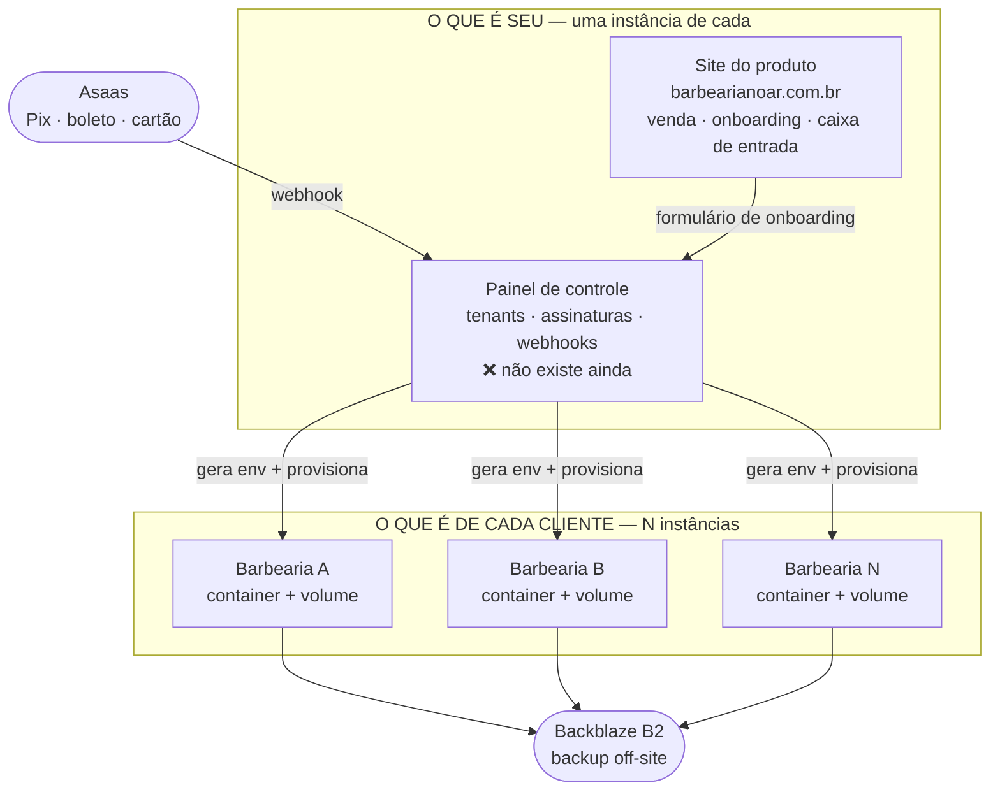
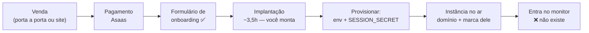

# Arquitetura de produção — como fica com N barbearias

> Data: 2026-09-01. Documento de referência.
> Status: **o desenho descreve o alvo; a maior parte ainda não está montada.**
> O que já roda hoje está marcado ✅; o que não existe, ❌.
>
> Companheiros nesta mesma pasta: `ARQUITETURA-PRODUTO-V1.md` (o sistema da
> barbearia), `ARQUITETURA-COBRANCA-V1.md` (o dinheiro), `PENDENCIAS-ABERTAS.md`
> (o que falta decidir).
>
> ⚠️ `PRECIFICACAO.md` é citado aqui e no `ARQUITETURA-COBRANCA-V1.md`, mas **não
> existe em repositório nenhum** — vive só no projeto do Claude. Verificado em
> 01/09/2026: não está em `C:\DEV\barbearia\docs` nem em `C:\DEV\produto\docs`.
> Vale trazer para cá: um documento citado por documento versionado não deveria
> depender de outro lugar para existir.
>
> Contagens conferidas por listagem do repositório em 01/09/2026 — **49 rotas de API**
> e **9 arquivos de teste**. Os outros documentos dizem 46/47 rotas e 7 testes: estão
> desatualizados, foram escritos antes das rotas de mídia e de configurações.

---

## 1. O que este documento resolve

As peças da produção estavam espalhadas em quatro documentos e nenhum mostrava o
conjunto. Este mostra: **o que roda onde, quando N barbearias estiverem pagando.**

## 2. O desenho



**A regra que sustenta o desenho: a instância da barbearia nunca sabe que dinheiro
existe.** Se o webhook de cobrança quebrar, nenhuma agenda de sábado sai do ar. É a
mesma decisão do `ARQUITETURA-COBRANCA-V1.md` §2, vista de cima.

## 3. Anatomia de uma instância

Um container da **imagem única** + um volume + um punhado de variáveis:

```
DATABASE_PATH=/data/appointments.db
SESSION_SECRET=<gerado na hora, 64 hex — ÚNICO por instância>
TZ=America/Fortaleza
SITE_URL=https://barbeariax.com.br
S3_ENDPOINT / S3_BUCKET / S3_ACCESS_KEY_ID / S3_SECRET_ACCESS_KEY
```

O volume guarda `appointments.db`, `uploads/` e `backups/`.

**Nada mais distingue a Barbearia A da B.** Cor, logo, fotos, textos, serviços,
horários — tudo é linha no banco dela. Foi a Fase 1 (marca vindo do banco) e a Fase 5
(cor de destaque) que destravaram isso.

> 🔴 **`SESSION_SECRET` repetido = admin de uma loja vira admin da outra.** O cookie
> carrega só `{barberId, role}` e tem o mesmo nome em toda instância. O provisionamento
> **gera**, nunca copia. Atenuante verificado: o cookie é host-only (sem atributo
> `Domain`), então o ataque exige copiar o cookie na mão — reduz a probabilidade, não a
> gravidade.

## 4. Roteamento e certificado

Traefik do EasyPanel emitindo certificado por host sob demanda (HTTP-01).

- **Subdomínio nosso** — um registro DNS curinga `*.barbearianoar.com.br` aponta para o
  IP do VPS. Cliente novo não dá trabalho nenhum.
- **Domínio próprio do cliente** — registrar, apontar, adicionar o host. ~15 minutos
  manuais, dentro da implantação. É o que mais reforça a venda; não vale automatizar.

A escolha entre os dois **ainda está aberta** (`PENDENCIAS-ABERTAS.md` §1.1). A tela
`/acessar` do site do produto já aceita as duas formas, então a decisão não a bloqueia.

## 5. Como uma barbearia nova entra



Hoje os passos de provisionar e monitorar são manuais. O script que automatiza o
provisionamento é a Fase 6 e **só se paga por volta do oitavo cliente** — a 1 cliente
por mês, fazer na mão custa uma ou duas horas por venda contra 10 a 15 horas para
construir o script.

## 6. Decisões desta camada

### D-P1 — Endpoint de saúde por instância 🔴

**Não existe rota de saúde hoje** (verificado nas 49 rotas). Isso deixa três perguntas
sem resposta quando há mais de uma instância:

1. Estão todas no ar?
2. Estão todas na mesma versão da imagem?
3. Alguma migration ficou pela metade?

Uma rota pública `GET /api/health` devolvendo versão da imagem, contagem de migrations
aplicadas e um `ok` responde as três de uma vez. É pouco código e é o que transforma
"monitoramento" de projeto grande em um cron que bate em N URLs.

```json
{ "ok": true, "versao": "<git sha>", "migrations": 10, "hora": "2026-09-01T12:00:00Z" }
```

Sem dado de cliente na resposta — ela é pública.

### D-P2 — Deploy em canário, nunca em bloco 🔴

`scripts/startup.mjs` aplica as migrations **no boot do container**. Consequência: subir
uma versão nova é subir N containers, cada um rodando migration por conta própria. Se a
migration falhar na instância 7, aquela barbearia fica fora e as outras seguem — **em
versões de schema diferentes, sem ninguém perceber** (é o que a D-P1 resolve enxergar).

Ordem obrigatória, sem exceção:

1. **Demo** (barbearia fictícia, ninguém depende dela)
2. **Um cliente real**, e esperar um dia
3. **O resto**

Custa zero e é a diferença entre derrubar uma barbearia e derrubar quinze num sábado.

> ⚠️ **9 arquivos de teste para 49 rotas.** Atualizar 15 negócios de verdade com essa
> cobertura é o maior risco operacional do produto — maior que qualquer bug isolado. O
> canário é o que compra tempo enquanto a cobertura não cresce.

### D-P3 — O que é seu não mora junto com o que é deles 🟠

O site do produto e o painel de controle **não devem ficar no mesmo VPS das instâncias
dos clientes.** Se aquela máquina cai, você perde os sites dos clientes *e* a sua
capacidade de vender e de avisar que está resolvendo.

**Rejeitado para o começo:** um VPS por cliente. O custo por barbearia sairia de
R$ 10,83 para R$ 78 e destruiria a margem (`PRECIFICACAO.md` §5).

## 7. Capacidade e raio de dano

| Item | Valor | Origem |
|---|---|---|
| Instâncias por VPS de 8 GB | ~12 | estimativa conservadora, **não medida** |
| Custo de infra por cliente/mês | R$ 10,83 | `PRECIFICACAO.md` §5 |
| VPS Hostinger KVM2, renovação | R$ 77,99/mês | conferido em 28/08/2026 |

A 15 clientes você tem cerca de **R$ 2.700/mês de receita numa máquina só**. Não é
argumento para espalhar agora — é o número que diz quando parar de adiar a réplica.

Medir de verdade custa pouco: `docker stats` com 5 containers vazios
(`PENDENCIAS-ABERTAS.md` §5).

## 8. Trajetória

Quase nada deste documento precisa existir hoje. A ordem em que cada peça se paga:

| Clientes | O que passa a valer a pena |
|---|---|
| **1 – 3** | Nada. Assinatura criada na mão no Asaas, deploy clicando no EasyPanel. É o certo, não é gambiarra. |
| **2** | D-P1 (saúde) e D-P2 (canário). Baratos, e é quando existe um segundo negócio para derrubar. |
| **4 – 5** | Painel de controle (54–74h). Criar assinatura na mão começa a irritar. |
| **8** | Script de provisionamento (Fase 6). |
| **12** | Segundo VPS, ou a medição que prove que cabe mais. |
| **15 – 25** | Reabrir o multi-tenant — com receita para bancar e clientes reais dizendo o que precisam. |

## 9. O que continua em aberto

Nada aqui é decisão nova; é o mapa do que este desenho depende.

| Item | Onde |
|---|---|
| Onde as instâncias rodam, e o plano de capacidade | `PENDENCIAS-ABERTAS.md` §3.1 |
| Processo de atualizar N containers | `PENDENCIAS-ABERTAS.md` §3.2 |
| Estrutura de backup por cliente **e um teste de restauração** | `PENDENCIAS-ABERTAS.md` §3.3 |
| Monitoramento (é o que a D-P1 viabiliza) | `PENDENCIAS-ABERTAS.md` §3.4 |
| Subdomínio nosso ou domínio próprio do cliente | `PENDENCIAS-ABERTAS.md` §1.1 |
| Cobertura de teste antes de 15 instâncias | `ARQUITETURA-COBRANCA-V1.md` §11 |

**Backup nunca restaurado é backup que não existe.** O teste de restauração é o único
item desta lista que vale fazer antes do primeiro cliente pagante.
