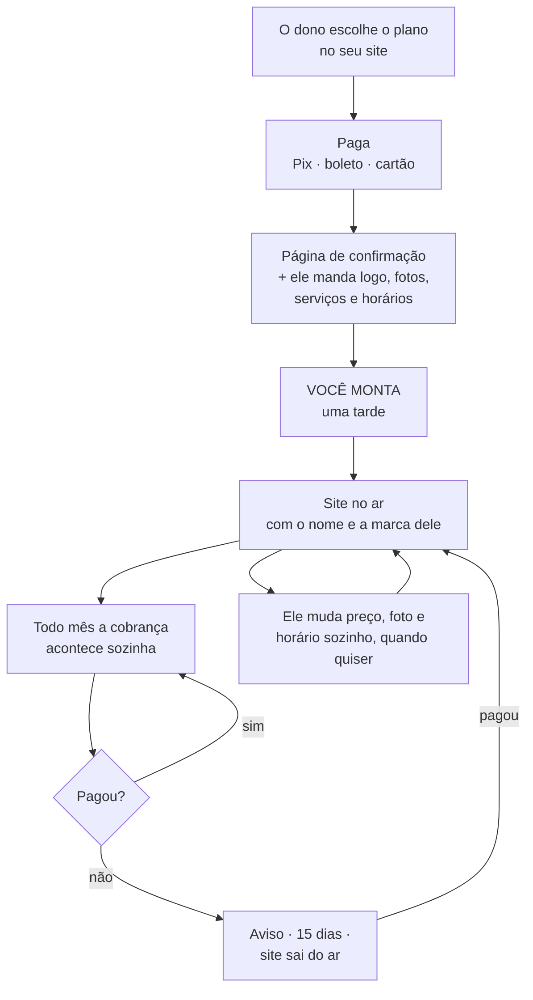

# Como o produto funciona — explicação sem termos técnicos

> Data: 2026-08-30. Documento de referência, escrito em português claro.
>
> Este é o documento para ler quando a discussão travar em detalhe técnico e for
> preciso lembrar **o que estamos construindo e por quê**.
>
> Os outros documentos explicam *como fazer*: `ARQUITETURA-PRODUTO-V1.md` (o site),
> `ARQUITETURA-COBRANCA-V1.md` (o dinheiro), `PRECIFICACAO.md` (os números),
> `PLANO-PRODUTIZACAO.md` (a decisão de negócio) e `PENDENCIAS-ABERTAS.md` (o que falta).

---

## Em uma frase

Cada barbearia paga uma entrada e uma mensalidade para ter o próprio site com
agendamento — montado por você na entrada, e cuidado por você para sempre.

---

## O mal-entendido que este documento resolve

**SaaS é um jeito de vender, não um jeito de programar.**

O que faz um cliente sentir que está usando um SaaS é isto:

- ele não compra o programa, paga um valor todo mês para usar;
- não instala nada, não cuida de servidor, não faz backup;
- recebe as melhorias que você constrói sem pagar de novo por elas;
- pode cancelar.

Este produto faz tudo isso. A única coisa que ele **não** faz é o cadastro
automático — a pessoa se inscrever sozinha e sair usando no mesmo minuto.

E cadastro automático não é o que define um SaaS. É só uma das formas de entregar
um. A Netflix é SaaS e você se cadastra sozinho; a maior parte dos sistemas que
empresas assinam também é SaaS e tem alguém do outro lado montando a conta na
primeira semana. As duas coisas são SaaS.

---

## A imagem: um prédio de apartamentos

Você tem uma **planta de apartamento** — o projeto, um só.

Cada barbearia recebe **um apartamento próprio**. Mesma planta, decoração
diferente: a cor da parede, os quadros, os móveis, cada um escolhe o seu.

Três coisas saem de graça dessa arrumação:

- **Ninguém entra no apartamento do outro.** A lista de clientes de uma barbearia
  não pode aparecer para a barbearia da esquina, e não pode mesmo — não é uma
  regra que alguém possa esquecer de aplicar, é parede.
- **Melhoria na planta vale para todos.** Quando você constrói alguma coisa nova,
  ela chega em todos os apartamentos. Você não constrói dez vezes.
- **O que diferencia a Barbearia A da Barbearia B nunca é a planta.** É só a
  decoração. No dia em que uma barbearia exigir uma planta diferente, você deixou
  de ter um produto e passou a ter dez prédios para cuidar sozinho.

Quando o prédio enche, você constrói outro. Hoje cabem cerca de doze barbearias
por prédio, e um prédio custa uns R$ 78 por mês.

---

## O caminho do dono da barbearia

**1. Ele escolhe e paga.** Entra no seu site, vê o plano, paga — Pix, boleto ou
cartão. Isso acontece sozinho, sem você.

**2. Ele já começa a fazer alguma coisa.** Na hora cai numa página que confirma o
pagamento, diz em quantos dias o site fica pronto, e pede o que só ele tem: o
logo, as fotos dos cortes, a lista de serviços com os preços, os horários em que
atende. Ele preenche ali mesmo, enquanto está animado com a compra.

**3. Você monta.** Uma tarde. Escolhe as fotos boas, corta, trata, escreve os
textos, cadastra os serviços, configura contato e horários, aponta o endereço.

**4. Ele recebe o link.** É o site dele, com o nome dele, no endereço dele. O
cliente da barbearia já entra e marca horário sozinho.

**5. Todo mês a cobrança se repete.** Ele não faz nada. Se atrasar, recebe um
aviso; quinze dias depois o site sai do ar até ele pagar. Assim que paga, volta —
e nada se perde nesse meio-tempo.

**6. Ele mexe no próprio site.** Mudou o preço do corte, tirou uma foto ruim,
mudou o horário de sábado: ele entra numa área dele e muda. Não precisa te chamar.

Do lado dele, isso é igual a qualquer serviço que ele assina. Escolheu na
internet, pagou, recebeu, paga todo mês.

---

## Quem faz o quê

| Acontece sozinho | Precisa de você |
|---|---|
| A venda no site e o pagamento | A conversa que traz o cliente |
| A cobrança de todo mês | A montagem do site na entrada |
| O aviso de atraso | Apertar o botão de cortar quem não pagou |
| O backup diário de tudo | O suporte quando ele tem dúvida |
| O dono mudando o próprio site | Construir o que for novo |

---

## Por que existe uma tarde sua no meio

Esta é a parte que mais gera dúvida, então vale por escrito.

**Motivo 1 — sem ela, o produto nasce vazio.** Se o dono se cadastrasse e começasse
a usar na hora, o site dele apareceria sem foto, sem serviço, sem texto. Ele
abriria, veria uma casca cinza e desistiria. A primeira impressão do produto, para
todo cliente novo, passaria a ser a pior versão dele que existe.

**Motivo 2 — é ela que se vende.** O que o dono compra não é o programa; é o site
pronto. É por isso que dá para cobrar R$ 2.500 na entrada. Se ele montasse
sozinho, o que sobraria para vender seria agendamento — e agendamento os
concorrentes vendem por R$ 76 a R$ 100 por mês, sem entrada nenhuma. A conta muda
assim:

| | Com a montagem | Se ele montasse sozinho |
|---|---|---|
| Entrada | R$ 2.500 | R$ 0 |
| Mensalidade | R$ 180 | R$ 99 (o que o mercado paga) |
| **Primeiro ano, por cliente** | **R$ 4.660** | **R$ 1.188** |
| Clientes para R$ 2.500/mês | 15 | 29 |

A tarde no meio não é uma limitação que falta resolver. É o produto.

### O que faria mudar de ideia

Registrado para não ser uma decisão permanente por inércia. O cadastro automático
passa a fazer sentido quando **as três** coisas abaixo forem verdade ao mesmo tempo:

1. Você não consegue mais falar com cada cliente — porque as vendas passaram a vir
   de fora de Mossoró, sozinhas, sem você ir até lá.
2. Existe um jeito de o site nascer decente sem alguém montando, provavelmente
   porque você já montou dez à mão e sabe exatamente o que perguntar.
3. Os números fecham no preço mais baixo, porque em cadastro automático não há
   entrada para cobrar.

Nenhuma das três é verdade hoje. A segunda só fica verdade **depois** de montar
alguns à mão — o que é mais um motivo para o caminho ser este primeiro.

---

## O que o dono pode mudar — e o que não pode

**Pode:** logo, fotos, cores, textos, nome, endereço, telefone, redes sociais,
lista de serviços com preços, horários, e quais partes da página aparecem. Quem
não tem galeria de fotos simplesmente não tem aquela seção — nada de bloco vazio.

**Não pode:** mudar o desenho da página, pedir uma seção que não existe, ter um
comportamento diferente do de todo mundo.

O limite é de propósito, e existe um teste simples para saber de que lado uma
conversa está:

> *"Vou fazer isso pra você"* → virou agência, e você perdeu.
> *"Vou adicionar como opção que todo mundo pode ligar"* → continua produto.

---

## O que muda quando crescer

Hoje cada barbearia tem o próprio apartamento. É simples, é seguro e o custo por
barbearia é quase nada — uns R$ 11 por mês somando tudo.

Lá pelas quinze ou vinte barbearias, atualizar todas uma a uma começa a doer. Nesse
ponto existe uma reforma maior que vale a pena fazer — e ela só vale a pena porque,
a essa altura, existe receita para bancá-la e clientes de verdade dizendo do que
precisam. Fazer essa reforma antes disso é gastar meses resolvendo um problema que
ainda não existe.

O sinal para reabrir o assunto é esse: **quando atualizar todo mundo virar um
incômodo real**, não antes.

---

## O que este documento não responde

| Pergunta | Situação |
|---|---|
| Como o produto se chama? | Sem resposta. Trava o endereço dos sites dos clientes. |
| R$ 2.500 + R$ 180 vende para quem não tem sistema nenhum? | Não testado. Cinco conversas respondem. É a maior incerteza do projeto. |
| Quem responde quando o dono manda mensagem às 21h de sábado? | Precisa estar escrito na proposta, ou vira plantão de graça. |
| Se o cliente sair, ele leva a lista de clientes dele? | A resposta certa é sim, com um arquivo para baixar. Ainda não existe. |
