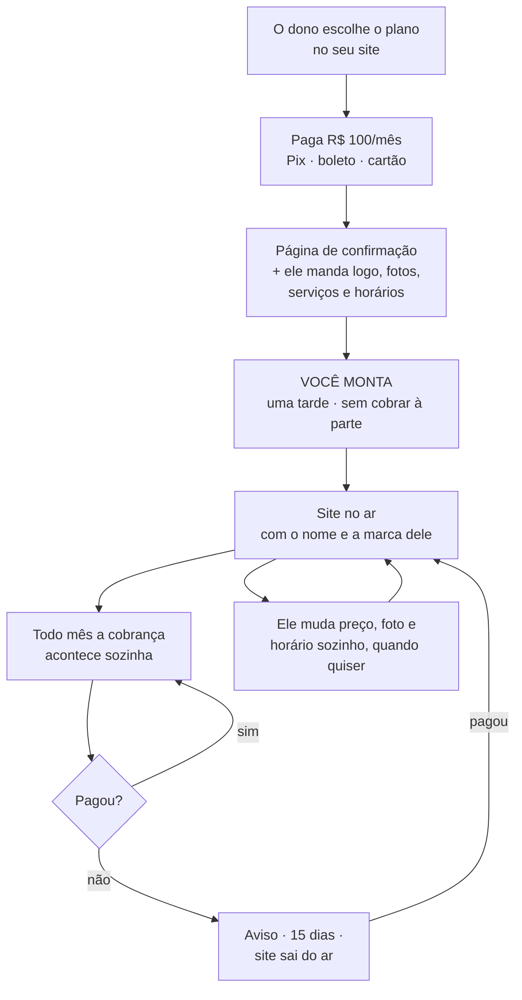

# Como o produto funciona — explicação sem termos técnicos

> Data: 2026-08-30. **Reescrito em 06/09/2026.** Documento de referência, em
> português claro.
>
> Este é o documento para ler quando a discussão travar em detalhe técnico e for
> preciso lembrar **o que estamos construindo e por quê**.
>
> **A reescrita foi necessária porque três coisas mudaram** depois da primeira
> versão: a taxa de instalação de R$ 2.500 foi abolida (30/08), a mensalidade caiu
> de R$ 180 para R$ 100 (01/09), e a arquitetura passou de uma instalação por
> cliente para multi-tenant (01/09). O que estava escrito aqui virou mentira nos
> três pontos. O histórico de cada decisão está no §7.
>
> ⚠️ **Mudou de novo em 24/09/2026, e desta vez o documento NÃO foi reescrito.** O
> dono decidiu por autoatendimento com 7 dias grátis: a barbearia se cadastra sozinha,
> recebe o painel na hora e escolhe entre três layouts de site, com as cores dele, depois
> de cadastrar o cartão (`PLANO-PRODUTIZACAO.md` §13). Tudo que aqui diz "você monta" — o passo 3 e o §6
> inteiro — descreve o que está no ar hoje e deixa de valer quando o novo fluxo existir.
> Reescrever antes disso poria aqui um produto que ainda não existe.
>
> Os outros documentos explicam *como fazer*: `ESTADO-ATUAL.md` (onde o código
> está), `ARQUITETURA-MULTI-TENANT-V1.md` (como o sistema é montado por dentro),
> `ARQUITETURA-COBRANCA-V1.md` (o dinheiro), `PRECIFICACAO.md` (os números) e
> `PENDENCIAS-ABERTAS.md` (o que falta decidir).

---

## 1. Em uma frase

Cada barbearia paga **R$ 100 por mês** para ter o próprio site com agendamento —
montado por você, sem cobrar nada por essa montagem, e cuidado por você para sempre.

---

## 2. O mal-entendido que este documento resolve

**SaaS é um jeito de vender, não um jeito de programar.**

O que faz um cliente sentir que está usando um SaaS é isto:

- ele não compra o programa, paga um valor todo mês para usar;
- não instala nada, não cuida de servidor, não faz backup;
- recebe as melhorias que você constrói sem pagar de novo por elas;
- pode cancelar.

Este produto faz tudo isso. A única coisa que ele **não** faz é o cadastro
automático — a pessoa se inscrever sozinha e sair usando no mesmo minuto.

E cadastro automático não é o que define um SaaS. É só uma das formas de entregar
um. A Netflix é SaaS e você se cadastra sozinho; a maior parte dos sistemas que
empresas assinam também é SaaS e tem alguém do outro lado montando a conta na
primeira semana. As duas coisas são SaaS.

---

## 3. A imagem: um prédio com fechadura central

Antes, cada barbearia ia ganhar **uma casa própria**: um programa rodando só para
ela, com o banco de dados dela num arquivo separado. A parede entre uma barbearia e
outra era física.

**Isso mudou em 01/09.** Agora é **um prédio só**: um programa, um banco de dados,
e cada barbearia é um apartamento dentro dele. A porta de cada apartamento tem uma
fechadura que **o próprio prédio controla** — a chave de uma barbearia não abre a
porta da outra, e quem decide isso é o prédio, não o morador.

O que se ganha e o que se paga com a troca:

| | Casa própria (antes) | Prédio com fechadura (agora) |
|---|---|---|
| Parede entre clientes | física | uma regra que o prédio faz valer |
| Subir uma melhoria | uma vez por casa | uma vez, vale para todos |
| Custo por barbearia | um programa rodando por cliente | dividido entre todos |
| O que pode dar errado | esquecer de atualizar uma casa | esquecer a fechadura numa porta |

**O risco novo, dito na cara:** com casas separadas, um erro de programação no
máximo quebrava a casa daquele cliente. Num prédio só, um erro num lugar pode fazer
a lista de clientes de uma barbearia aparecer para outra. Nome, telefone e data de
nascimento de gente real.

É por isso que existem duas paredes e não uma: o programa filtra, **e** o prédio
tem a fechadura. Uma consulta errada tem que passar pelas duas para vazar. E é por
isso também que cada tela nova nasce com um teste que tenta invadir o apartamento
do vizinho — escrito junto com a tela, nunca depois.

**O que não mudou:** o que diferencia a Barbearia A da Barbearia B continua sendo
só a decoração — logo, cores, fotos, textos, serviços. No dia em que uma barbearia
exigir uma planta diferente, você deixou de ter um produto.

---

## 4. O caminho do dono da barbearia

**1. Ele escolhe e paga.** Entra no seu site, vê o plano, paga — Pix, boleto ou
cartão. R$ 100 por mês, ou R$ 1.000 à vista pelo ano inteiro (paga dez meses, usa
doze). Isso acontece sozinho, sem você.

**2. Ele já começa a fazer alguma coisa.** Na hora cai numa página que confirma o
pagamento, diz em quantos dias o site fica pronto, e pede o que só ele tem: o logo,
as fotos dos cortes, a lista de serviços com os preços, os horários em que atende.
Ele preenche ali mesmo, enquanto está animado com a compra.

**3. Você monta.** Uma tarde — 3,5 horas na conta que está no `PRECIFICACAO.md`.
Escolhe as fotos boas, corta, trata, escreve os textos, cadastra os serviços,
configura contato e horários, aponta o endereço. **Isso não é cobrado à parte.**

**4. Ele recebe o link.** É o site dele, com o nome da barbearia dele no endereço.
O cliente da barbearia já entra e marca horário sozinho.

**5. Todo mês a cobrança se repete.** Ele não faz nada. Se atrasar, recebe um
aviso; quinze dias depois o site sai do ar até ele pagar. Assim que paga, volta — e
nada se perde nesse meio-tempo.

**6. Ele mexe no próprio site.** Mudou o preço do corte, tirou uma foto ruim, mudou
o horário de sábado: ele entra numa área dele e muda. Não precisa te chamar.

### 4.1 O endereço do site

**Todo cliente ganha um endereço nosso, de graça:** `barbeariax.fadeline.com.br`.

**Quem quiser o endereço próprio** — `barbeariax.com.br` — paga o registro, uns
R$ 40 por ano, no CPF ou CNPJ dele. Você aponta e opera.

Por que não incluir: a R$ 100 de mensalidade, R$ 40 por ano do seu bolso é meio mês
de margem por cliente, e quem cancela no mês 2 leva o registro junto.

Por que continuar oferecendo: verificado em 01/09 — **Trinks, AppBarber e Booksy só
oferecem subdomínio deles**. Poder ter o endereço próprio é o diferencial, e
oferecer como opção preserva ele sem comprar o custo.

---

## 5. Quem faz o quê

| Acontece sozinho | Precisa de você |
|---|---|
| A venda no site e o pagamento | A conversa que traz o cliente |
| A cobrança de todo mês | A montagem do site |
| O aviso de atraso | Apertar o botão de cortar quem não pagou |
| O backup diário de tudo | O suporte quando ele tem dúvida |
| O dono mudando o próprio site | Construir o que for novo |

---

## 6. Por que a montagem é sua, e de graça

**Motivo 1 — o site precisa nascer bom.** Se o dono recebesse um painel vazio para
usar na hora, o site dele apareceria sem foto, sem serviço, sem texto. Ele abriria,
veria uma casca cinza e desistiria. A primeira impressão do produto, para todo
cliente novo, passaria a ser a pior versão dele que existe.

**Motivo 2 — é ela que se vende.** O que o dono compra não é o programa; é o site
pronto. Se ele montasse sozinho, o que sobraria para vender seria agendamento — e
agendamento os concorrentes vendem mais barato.

**A conta hoje** (verificada em 01/09, detalhe em `PRECIFICACAO.md` §3 e §5):

| | Fadeline | Trinks | AppBarber | Booksy |
|---|---|---|---|---|
| Mensalidade | R$ 100 | R$ 76 | R$ 79,90 | R$ 99,99 |
| Quem monta a página | você | o dono | o dono | o dono |
| Endereço próprio possível | sim | não | não | não |

Você está **no mesmo preço do Booksy** e acima dos outros dois. O argumento deixa de
ser "custa mais porque entrega mais" e passa a ser **"custa o mesmo e entrega
mais"** — que é mais fácil de defender numa conversa.

A tarde no meio não é uma limitação que falta resolver. É o produto.

### 6.1 🔴 O suporte virou a condição do preço

Isto é o número mais importante deste documento.

A R$ 180, uma hora e meia de suporte por cliente por mês cabia com folga. **A
R$ 100, ela come 60% da mensalidade.**

| Suporte por cliente/mês | Margem por cliente | Com 10 clientes |
|---|---|---|
| 1,5 hora | R$ 29,17 | R$ 292 |
| 1,0 hora | R$ 49,17 | R$ 492 |
| **0,5 hora** | **R$ 69,17** | **R$ 692** |

*(a R$ 40/h de valor-hora e R$ 10,83 de infraestrutura por cliente)*

E a conta que decide: **a R$ 110 por hora** — que é o valor honesto de serviço, não
salário disfarçado — R$ 100 com 1,5h de suporte dá **prejuízo de R$ 75,83 por
cliente por mês**. A mesma conta com meia hora dá lucro de R$ 34,17.

**Consequência prática:** definir por escrito o que é "ajuste pequeno incluso na
mensalidade" deixou de ser burocracia e virou o que decide se existe negócio. Está
em aberto no `PENDENCIAS-ABERTAS.md`.

### 6.2 O que faria mudar de ideia sobre o cadastro automático

Registrado para não ser uma decisão permanente por inércia. O cadastro automático
passa a fazer sentido quando **as três** coisas abaixo forem verdade ao mesmo tempo:

1. Você não consegue mais falar com cada cliente — porque as vendas passaram a vir
   de fora de Mossoró, sozinhas.
2. Existe um jeito de o site nascer decente sem alguém montando, provavelmente
   porque você já montou dez à mão e sabe exatamente o que perguntar.
3. Os números fecham — e agora fechar é sobre o suporte caber em meia hora, não
   mais sobre ter uma entrada para cobrar.

Nenhuma das três é verdade hoje. A segunda só fica verdade **depois** de montar
alguns à mão.

---

## 7. O que o dono pode mudar — e o que não pode

**Pode:** logo, fotos, cores, textos, nome, endereço, telefone, redes sociais,
lista de serviços com preços, horários, e quais partes da página aparecem. Quem não
tem galeria de fotos simplesmente não tem aquela seção — nada de bloco vazio.

**Não pode:** mudar o desenho da página, pedir uma seção que não existe, ter um
comportamento diferente do de todo mundo.

O limite é de propósito, e existe um teste simples para saber de que lado uma
conversa está:

> *"Vou fazer isso pra você"* → virou agência, e você perdeu.
> *"Vou adicionar como opção que todo mundo pode ligar"* → continua produto.

---

## 8. Histórico — o que mudou e quando

Registrado para o debate não voltar em três meses. O raciocínio original de cada
decisão está preservado no documento correspondente, marcado como substituído.

| Quando | Era | Virou | Por quê |
|---|---|---|---|
| 30/08 | R$ 2.500 de entrada + R$ 180/mês | R$ 180/mês, sem entrada | O plano anual à vista substituiu a entrada como instrumento de caixa |
| 01/09 | R$ 180/mês | **R$ 100/mês**, meta de 10 clientes | Concorrentes verificados entre R$ 76 e R$ 99,99 |
| 01/09 | Domínio próprio incluso | Subdomínio incluso, próprio como opção paga | A R$ 100, R$ 40/ano do próprio bolso é meio mês de margem |
| 01/09 | Uma instalação por cliente | **Multi-tenant**, um banco só | Decisão do dono: escalável desde a base |
| 06/09 | Dois repositórios separados | Um repositório, dois aplicativos | `MONOREPO.md` |

**Rejeitado, e por quê:** manter uma instalação por cliente. Era mais simples e a
parede entre clientes era física — mas cobrava atualizar cada cliente à mão, e a
decisão foi construir escalável desde a base em vez de migrar doendo depois.

---

## 9. O que este documento não responde

| Pergunta | Situação |
|---|---|
| R$ 100 vende para quem não tem sistema nenhum? | **Não testado. É a maior incerteza do projeto.** Cinco conversas respondem. |
| Quanto de suporte cada cliente realmente dá? | Não medido. É o número que decide se existe margem (§6.1). |
| Quem responde quando o dono manda mensagem às 21h de sábado? | Precisa estar escrito na proposta, ou vira plantão de graça. |
| Se o cliente sair, ele leva a lista de clientes dele? | A resposta certa é sim, com um arquivo para baixar. Ainda não existe. |
| Quem paga a renovação do domínio próprio no ano 2? | Em aberto. |

O que **já** tem resposta e saiu desta lista: o nome do produto (Fadeline, provisório
desde 08/10 — antes, Barbearia no Ar), o preço (§8) e o endereço dos sites dos clientes
(§4.1).
