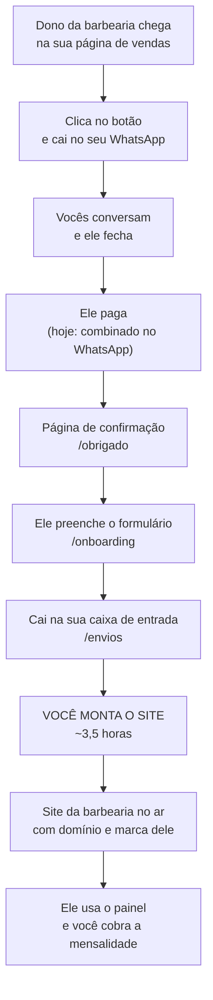
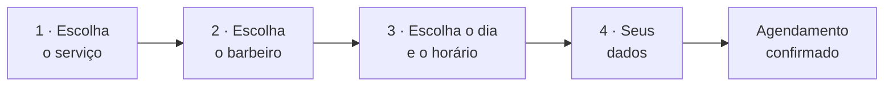

# Fluxo completo — da página de vendas até o site da barbearia no ar

> Data: 2026-08-30. Revisado em 06/09/2026. Documento de referência.
>
> ⚠️ **Os caminhos de arquivo são anteriores ao monorepo.** Onde se lê a raiz do
> projeto do produto, hoje é `apps/vendas/`; o app da barbearia é `apps/barbearia/`.
> Ver `MONOREPO.md`. O **fluxo** continua correto; o que mudou foi onde os arquivos
> moram.
>
> ⚠️ **A arquitetura mudou:** de instância por cliente para multi-tenant com banco
> único (`ARQUITETURA-MULTI-TENANT-V1.md`, 01/09). A parte 3 descreve o que a
> barbearia recebe, o que não muda; muda como isso é servido por baixo.
>
> ⚠️ **Este fluxo vai ser aposentado** — decisão de 24/09/2026
> (`PLANO-PRODUTIZACAO.md` §13). O caminho `/onboarding` → `/envios` → você monta dá
> lugar ao autoatendimento: o dono se cadastra sozinho em `/cadastrar`, recebe o painel
> na hora e tem 7 dias grátis. O documento continua certo sobre o que está no ar **hoje**;
> deixa de valer no dia em que o `/onboarding` sair (`PENDENCIAS-ABERTAS.md` §4.15).
> O caminho novo, passo a passo, com o que existe e o que falta, está em
> `JORNADA-DO-BARBEIRO.md` (27/09/2026).
>
> **Todo item deste documento foi conferido no código**, arquivo por arquivo, na
> data acima. Contagens de telas e rotas vêm de listagem do repositório, não de
> memória. O que ainda não existe está marcado como tal — não há nada aqui
> descrito como pronto que não esteja funcionando.
>
> Companheiros: `COMO-FUNCIONA.md` (o modelo em português claro),
> `ARQUITETURA-COBRANCA-V1.md` (o desenho do pagamento),
> `ARQUITETURA-PRODUTO-V1.md` (as fases técnicas), `PRECIFICACAO.md` (os números).

---

## 1. O caminho inteiro, de ponta a ponta



Existem **dois programas separados** nesse caminho, e a separação é deliberada:

| | O quê | Onde mora | Porta local |
|---|---|---|---|
| **Site do produto** | Vende, recebe o onboarding, é a sua caixa de entrada | `C:\DEV\produto` | 4321 (recomendado mudar para 4322) |
| **Sistema da barbearia** | O que você entrega para cada cliente | `C:\DEV\barbearia` | 4321 |

Se as páginas de venda morassem no repositório da barbearia, o container de cada
cliente serviria uma oferta sua — e um cliente da Barbearia do Zé digitaria
`/planos` no site dele e cairia numa página vendendo o sistema. Por isso são dois.

---

## 2. Parte 1 — O site do produto

Sete telas. Quatro públicas, uma de porta, duas atrás de senha.

| Rota | O que é | Situação |
|---|---|---|
| `/` | Página de vendas: a dor, o que ele recebe, comparação com os concorrentes, como funciona, preço, perguntas frequentes | ✅ pronta |
| `/demo` | Quatro telas do sistema explicadas, com moldura para as imagens | ⚠️ pronta, **sem as imagens** |
| `/obrigado` | Confirmação de pagamento, prazo e o que acontece agora | ✅ pronta |
| `/onboarding` | Formulário onde o dono manda logo, fotos, serviços e horários | ✅ pronto e salvando |
| `/entrar` | Login da área fechada | ✅ pronto |
| `/envios` | Sua caixa de entrada: lista de quem enviou | ✅ pronta |
| `/envios/{protocolo}` | O envio inteiro, com as fotos na tela | ✅ pronta |

Quatro rotas de programa sustentam isso:

| Método e rota | O que faz |
|---|---|
| `POST /api/onboarding` | Recebe o formulário, valida, grava as fotos e devolve o protocolo |
| `POST` e `DELETE /api/entrar` | Entra e sai da área fechada |
| `PATCH /api/envios/{protocolo}` | Muda o estado do envio (novo · em andamento · concluído) |
| `GET /api/uploads/{protocolo}/{arquivo}` | Serve as fotos, só para quem está logado |

### 2.1 O que acontece quando ele aperta "Enviar"

O navegador manda tudo para `/api/onboarding`. O servidor confere os campos,
recusa arquivo que não seja imagem e arquivo acima de 15 MB, renomeia as fotos
para `01.png`, `02.png` — o nome original nunca vai para o disco — e grava:

```
data/produto.db              tabela `onboarding`: textos, serviços, horários
data/uploads/{protocolo}/    as fotos
```

O dono recebe um protocolo curto na tela, tipo `KCCY-477`, sem letras que se
confundem ao telefone. É por ele que você acha o envio quando o cliente ligar.

### 2.2 O que ainda não existe nesta parte

**Cobrança.** O botão da página de vendas leva para o WhatsApp, de propósito. A
conta no Asaas exige CPF ou CNPJ e a integração de assinaturas são de 20 a 30
horas. Quando existir, `/obrigado` passa a ser o destino do retorno do pagamento.

**Aviso de envio novo.** Nada te notifica. Você abre `/envios` para saber. Com um
cliente por mês isso resolve; quando incomodar, o próximo passo é e-mail.

**Imagens da demonstração.** As molduras esperam quatro arquivos em `public/demo/`.
Não use as fotos da Barbearia Bayron ali: são a marca dele, os depoimentos são de
clientes reais com nome e sobrenome, e mostrar isso para barbearias concorrentes da
mesma cidade é indefensável. As saídas estão no `README.md` do projeto.

---

## 3. Parte 2 — A implantação

É o que você faz entre o envio chegar e o site subir. É **serviço**, cobrado uma
vez na entrada, e é ele que responde por 54% da receita do primeiro ano de cada
cliente.

1. Abrir o envio em `/envios/{protocolo}` e usar **"Copiar tudo em texto"**
2. Escolher as fotos boas, cortar e tratar
3. Criar a instância da barbearia (container e volume próprios)
4. Preencher **Admin → Configurações** com o que veio no formulário
5. Cadastrar serviços, preços, barbeiros e horários
6. Registrar o domínio no nome do cliente e apontar
7. Conferir e entregar o link com a senha do painel

Os passos 3 e 6 são manuais hoje. O script que automatiza o passo 3 é a Fase 6, e
só se paga por volta do oitavo cliente — a 1 cliente por mês, fazer na mão custa
uma ou duas horas por venda contra 10 a 15 horas para construir o script.

---

## 4. Parte 3 — O sistema que a barbearia recebe

**23 telas e 54 rotas de programa** — recontado em 25/09/2026 (eram 21 e 47 quando este documento foi escrito). Divididas em três públicos.

### 4.1 O que o cliente da barbearia vê

| Rota | O que é |
|---|---|
| `/` | A página da barbearia: topo com foto, galeria, combo do dia, serviços com preço, produtos, depoimentos, localização com mapa, perguntas frequentes, rodapé e botão flutuante de WhatsApp |
| `/agendar` | O agendamento em 4 passos |
| `/a/{token}` | O agendamento dele: ver, remarcar, cancelar, baixar para o calendário |
| `/cliente/entrar` | Entra com telefone e data de nascimento |
| `/cliente` | Os agendamentos dele |
| `/portal` | Porta de entrada: cliente, barbeiro ou agendar |
| `/404` | Página não encontrada |

**Os 4 passos do agendamento**, conferidos no código:



Só aparecem horários realmente livres — o sistema recusa encaixe em cima de outro
agendamento, com verificação no servidor e chave de idempotência para o mesmo
clique duplo não criar dois horários.

> ⚠️ O passo 2 aparece **mesmo quando a barbearia tem um barbeiro só**. Para o alvo
> comercial — barbearia pequena, boa parte com um profissional — é um passo inútil
> no ponto mais sensível do funil. Está registrado em `PENDENCIAS-ABERTAS.md` §2.2
> e continua aberto.

### 4.2 O que o dono e os barbeiros veem — 15 telas

Acesso em `/admin/login`. Duas permissões: **admin** (o dono) e **barbeiro**.

| Tela | O que faz | Quem acessa |
|---|---|---|
| `/admin` | Visão geral: semana, mês, receita da semana, próximos das 48h | todos |
| `/admin/dia/{data}` | A agenda do dia: quem vem, próximo da fila, receita prevista, fechar comanda, vender produto | todos |
| `/admin/buscar` | Busca cliente por telefone ou nome | todos |
| `/admin/reservas` | Reservas de produto para retirar na loja | todos |
| `/admin/servicos` | Serviços e preços; para o dono, o catálogo completo | todos (visão muda) |
| `/admin/horarios` | Horário de expediente por barbeiro | todos |
| `/admin/bloqueios` | Folgas, feriados, almoços | todos |
| `/admin/relatorios` | Receita realizada e perdida, ticket médio, no-show, ocupação da cadeira, movimento por horário, receita por barbeiro, o que mais fatura, clientes únicos do mês | todos |
| `/admin/produtos` | Cadastro dos produtos que aparecem no site | **só admin** |
| `/admin/combos` | Serviço + produto com desconto, por dia da semana | **só admin** |
| `/admin/galeria` | As fotos do carrossel da página inicial: enviar várias de uma vez, ordenar, remover. A seção só aparece no site a partir de 3 fotos (desde 25/09/2026) | **só admin** |
| `/admin/barbeiros` | Cadastro, permissão e senha da equipe | **só admin** |
| `/admin/configuracoes` | Nome, contato, endereço, horário de vitrine, avaliações, textos de busca | **só admin** |
| `/admin/catalogo` | Redirecionamento — a tela foi fundida em Serviços | — |
| `/admin/login` | Entrada do painel | — |

### 4.3 As rotas de programa

Não precisam ser conhecidas uma a uma, mas vale saber o desenho. A divisão abaixo é a da
primeira versão, com 47; depois entraram o cadastro, a mídia da marca e a galeria — hoje são
54 arquivos em `src/pages/api/`.

- **29 rotas administrativas** — agendamentos (cancelar, concluir, remarcar, marcar falta, anotações, histórico, busca, calendário), barbeiros, serviços, produtos, combos, reservas, vendas avulsas, horários, bloqueios, configurações e backup.
- **4 rotas do link do cliente** — ver, remarcar, cancelar e baixar o `.ics` do calendário.
- **14 rotas públicas e de sessão** — criar agendamento, listar barbeiros e serviços, consultar horários livres, produtos, combos, reservas, e as entradas e saídas de barbeiro e de cliente.

---

## 5. Situação real de cada parte

| Parte | Situação |
|---|---|
| Site de vendas do produto | ✅ pronto — falta só trocar `NOME PROVISÓRIO` em `src/config.ts` |
| Formulário de onboarding | ✅ pronto, salvando textos e fotos |
| Caixa de entrada dos envios | ✅ pronta, protegida por senha |
| Página de demonstração | ⚠️ pronta, faltam as quatro imagens |
| Cobrança automática | ❌ não existe — WhatsApp, de propósito |
| Aviso de envio novo | ❌ não existe |
| Sistema da barbearia | ✅ funcionando em produção |
| Marca vindo do banco (Fase 1) | ✅ pronta e verificada |
| Painel de configurações (Fase 4) | ✅ parcial — o que já está na tabela |
| Logo e fotos pelo painel (Fase 2) | ❌ ainda vêm do código |
| Depoimentos, FAQ e catálogo pelo painel (Fase 3) | ❌ ainda em arquivo |
| Cor de destaque configurável (Fase 5) | ❌ coluna existe, site não lê |
| Provisionamento automático (Fase 6) | ❌ manual |
| Barbearia de exemplo no ar (Fase 7) | ❌ não existe |

---

## 6. O que trava o quê

**Trava a primeira venda:** o nome do produto. A página de vendas está pronta e
publicável no dia em que ele existir. Nada mais bloqueia.

**Trava o segundo cliente:** nada de código. A Fase 1 tornou possível uma segunda
instância sem copiar o repositório. A implantação vai custar mais que 3,5 horas
até as Fases 2 e 3, mas é fazível.

**Trava a cobrança automática:** nome do produto, domínio para os subdomínios, e
conta no Asaas com CPF ou CNPJ.

**Não trava nada, e continua sendo a maior incerteza do projeto:** saber se o preço
vende para uma barbearia que não tem sistema nenhum. Isso não se resolve escrevendo
código. São cinco conversas.

> ⚠️ **O preço mudou duas vezes desde que isto foi escrito.** Era R$ 2.500 de entrada
> mais R$ 180/mês; a entrada foi abolida em 30/08 e a mensalidade caiu para **R$ 100**
> em 01/09. A incerteza continua a mesma, mas agora sobre um número que compete de
> frente com AppBarber (R$ 79,90) e Booksy (R$ 99,99). Ver `PRECIFICACAO.md`.
