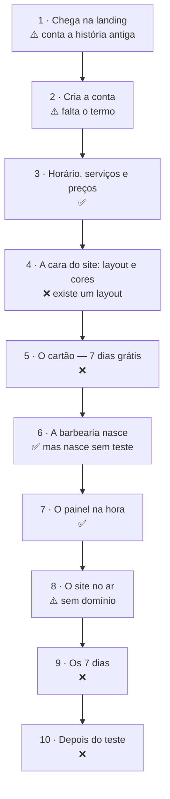

# Jornada do barbeiro — da landing ao painel e ao site no ar

> Escrito em 27/09/2026. **Roteiro para construir** o autoatendimento decidido em 24/09
> (`PLANO-PRODUTIZACAO.md` §13): o caminho que o dono de uma barbearia percorre sozinho,
> do anúncio até o site dele recebendo agendamento.
>
> Cada passo diz **o que ele vê**, **o que o sistema faz**, **o que já existe** no código —
> conferido arquivo por arquivo nesta data, referências `arquivo:linha` literais —, **o que
> falta** e **o que pode dar errado**.
>
> Status: **desenho, implementado em parte.** Dos dez passos, três funcionam, três existem
> pela metade e quatro não existem. O que funciona está fechado atrás de
> `CADASTRO_ABERTO=1`; nada disto está aberto em produção.
>
> Companheiros: `PENDENCIAS-ABERTAS.md` §6 (a ordem de trabalho, que o §5 abaixo detalha),
> `PENDENCIAS-ABERTAS.md` §4.14 (o teste e a cobrança), `ARQUITETURA-COBRANCA-V1.md` (a
> Asaas) e `FLUXO-COMPLETO.md` (o caminho antigo, com montagem, que este substitui quando
> estiver pronto).

**Legenda:** ✅ existe e foi visto funcionando · ⚠️ existe pela metade · ❌ não existe

---

## 1. O caminho inteiro

| Passo | O que é | Hoje |
|---|---|---|
| 1 | Chega na landing e aperta o botão | ⚠️ o botão principal leva ao WhatsApp |
| 2 | Cria a conta: nome, endereço do site, WhatsApp, senha | ⚠️ existe; falta o termo aceito |
| 3 | Horário, serviços e preços | ✅ |
| 4 | Escolhe o layout e as cores | ❌ existe um layout; a cor, só no painel |
| 5 | Cadastra o cartão | ❌ nenhuma linha de código |
| 6 | A barbearia é criada | ✅ mas nasce `active`, sem data de fim de teste |
| 7 | Entra no painel | ✅ já logado, desde 25/09 |
| 8 | O site vai ao ar | ⚠️ funciona em desenvolvimento; não há domínio |
| 9 | Os 7 dias grátis | ❌ |
| 10 | A primeira cobrança, e o que vem depois | ❌ |

**O que já dá para mostrar hoje, de ponta a ponta,** na sua máquina, com
`CADASTRO_ABERTO=1` nos dois aplicativos e `DOMINIO_BASE=localhost:4321` no da barbearia:
o botão "Criar a minha agora" da landing leva ao `/cadastrar`, e dali saem o painel já
logado, a galeria e o site em `<endereço>.localhost:4321`, agendando. Do `/cadastrar` em
diante, é o caminho conferido ao vivo em 25/09/2026 com o build de produção
(`ESTADO-ATUAL.md` §8). O que não dá para mostrar é tudo que envolve dinheiro, layout e
prazo.

---

## 2. Passo a passo

### 2.1 Passo 1 — Ele chega na landing

**O que ele vê.** A página de vendas: o que recebe, o preço e um botão.

**Hoje:**

- Os botões que vendem — o do cabeçalho, o do topo e o do preço — abrem o **WhatsApp**
  (`apps/vendas/src/pages/index.astro:7-8`, usados em `index.astro:68`, `index.astro:100`
  e `index.astro:275`). O de cadastro, "Criar a minha agora", só aparece com
  `CADASTRO_ABERTO` (`index.astro:117`), e de propósito como terceiro botão
  (`index.astro:109-116`).
- A página inteira conta a montagem: *"sem você montar nada"*, *"eu monto inteira"*
  (`PENDENCIAS-ABERTAS.md` §4.15).
- O cartão de preço diz *"cancela quando quiser, avisando 30 dias"* (`index.astro:250`),
  promete *"Endereço próprio com o nome da sua barbearia"* (`index.astro:252`) e vende o
  plano *"Anual, à vista"* (`index.astro:262`).

**O que falta:**

- O botão principal vira **"Começar os 7 dias grátis"**, levando ao `/cadastrar`.
- **Embaixo do botão, antes de ele gastar cinco minutos no formulário:** *"Pede cartão de
  crédito. Nada é cobrado antes do 8º dia."* É o aviso que evita o pior caso — preencher
  tudo e descobrir no fim que precisa de um cartão que ele não tem.
- A reescrita da tese (`PENDENCIAS-ABERTAS.md` §4.15), por último, quando o resto existir.

**O que pode dar errado:**

- **"Avisando 30 dias" e "7 dias grátis" não se combinam sozinhos.** Se ele cancelar no 6º
  dia, precisa não pagar nada; depois de pagar, o aviso de 30 dias pode significar mais
  uma cobrança. Os dois têm que estar ditos do mesmo jeito na landing, no cadastro e no
  termo (`PENDENCIAS-ABERTAS.md` §1.2).
- **"Endereço próprio"** lê-se como domínio dele. No autoatendimento ele recebe
  `endereco.<domínio do produto>`; o domínio próprio é opcional e pago à parte
  (`PENDENCIAS-ABERTAS.md` §0, decisão de 01/09).
- **O plano anual à vista não cabe** num teste de 7 dias com cartão sem uma decisão — ver
  o §4, abaixo.

### 2.2 Passo 2 — Ele cria a conta

**O que ele vê.** O `/cadastrar`, com a marca do produto e não a da barbearia, que ainda não
existe (`apps/barbearia/src/pages/cadastrar.astro:33-39`). Embaixo do título, *"Leva dois
minutos."* (`cadastrar.astro:124`). Uma página só, em cinco blocos
(`cadastrar.astro:130-181`):

- **A barbearia:** nome, **endereço do site** com a prévia de como vai ficar, rua, cidade.
- **Você:** o nome dele, **o WhatsApp** — que é o login e o contato do site ao mesmo tempo
  (`cadastrar.astro:152`) — e a senha.
- **Sua marca:** o Instagram e *"Como você descreveria a sua barbearia?"*, os dois
  opcionais.
- **Horário** e **serviços com preço** — o passo 3.

**O que o sistema faz, hoje:**

| Conferência | Onde |
|---|---|
| A tela responde 404 sem a chave | `apps/barbearia/src/pages/cadastrar.astro:20` |
| No máximo 5 cadastros por hora por endereço de rede | `apps/barbearia/src/pages/api/cadastrar.ts:83` |
| Só aceita JSON — página de outro site não cria conta nem loga ninguém | `apps/barbearia/src/pages/api/cadastrar.ts:94` |
| O endereço tem que servir de subdomínio | `apps/barbearia/src/lib/provisionarBarbearia.ts:210` |
| O endereço não pode estar tomado | `apps/barbearia/src/lib/provisionarBarbearia.ts:237` |
| O WhatsApp não pode ser o login de outro barbeiro, em barbearia nenhuma | `apps/barbearia/src/lib/provisionarBarbearia.ts:244` |

**O que falta:**

- **O termo de uso e a privacidade, aceitos aqui**, com a versão aceita gravada junto da
  barbearia (`PENDENCIAS-ABERTAS.md` §1.2). Sem ninguém no caminho, esta tela é o único
  lugar onde ele lê o combinado — inclusive quando o cartão vai ser cobrado.
- **Endereços reservados**: `www`, `painel`, `admin`, `api`, `app`, `mail` e o nome da
  marca (`PENDENCIAS-ABERTAS.md` §4.16).
- **Dizer que o endereço é para sempre.** O painel não tem como trocá-lo — a rota que grava
  a configuração, `api/admin/settings.ts`, não mexe em endereço nenhum —, e trocar quebraria
  todo link já compartilhado.

**O que pode dar errado:**

- **A senha criada às pressas é a que ele esquece.** Não existe "esqueci minha senha": hoje
  quem troca é você, rodando `scripts/set-admin-password.mjs`. No autoatendimento cada
  esquecimento vira um chamado, e o suporte precisa caber em meia hora por cliente
  (`PENDENCIAS-ABERTAS.md` §1.4). Registrado como decisão em `PENDENCIAS-ABERTAS.md` §4.17,
  com a regra manual para até lá.
- **Um WhatsApp para duas coisas.** Quem entra com o número pessoal e quer o da loja no
  site não tem como separar. O provisionador aceita um segundo número (`telefoneDono`,
  `apps/barbearia/src/lib/provisionarBarbearia.ts:48`), mas nem a tela nem a rota do
  cadastro o recebem (`apps/barbearia/src/pages/api/cadastrar.ts:61-74`).
- **Não pedimos e-mail** (`api/cadastrar.ts:61-74`). Sem ele não há como mandar recibo,
  aviso de cobrança nem link de troca de senha (`PENDENCIAS-ABERTAS.md` §4.17).

### 2.3 Passo 3 — Horário, serviços e preços

**O que ele vê.** Os dias da semana com abre-e-fecha, e oito serviços comuns já listados
— corte, degradê, barba, corte + barba, pezinho, infantil, sobrancelha, pigmentação —
esperando o preço dele (`apps/barbearia/src/lib/catalogoSugerido.ts:57`).

**Hoje: ✅.** O que ficar sem preço entra desligado: nenhum "R$ 0,00" vai para o ar
(`apps/barbearia/src/pages/cadastrar.astro:8-16`). E o horário não é enfeite: é dele que
saem as vagas do site.

**O que pode dar errado:**

- **Todos os preços em branco** = o site nasce com o botão "Reservar horário" levando a
  uma tela em branco (`PENDENCIAS-ABERTAS.md` §4.9). O cadastro avisa, mas deixa passar.
- **Os centavos somem**: R$ 39,90 aparece "R$ 40" no site, e editar o nome no painel grava
  R$ 39,00 (`PENDENCIAS-ABERTAS.md` §2.15).
- **Barbearia de um barbeiro só** ainda obriga o cliente a escolher barbeiro no agendamento
  (`PENDENCIAS-ABERTAS.md` §2.2) — e todo cadastro nasce com um barbeiro só, o dono.

### 2.4 Passo 4 — A cara do site: layout e cores

> **Decidido em 27/09/2026:** a escolha acontece **aqui, no cadastro, antes do cartão** —
> o site já nasce com a cara que ele escolheu. Rejeitado: escolher no painel, depois de
> entrar; o cadastro ficaria mais curto, mas o site nasceria no padrão e dependeria de ele
> lembrar de trocar.

**O que ele vê.** Três miniaturas do site — **com o nome dele, a cor dele e os serviços que
acabou de preencher**, não fotos de exemplo — e a escolha da cor. O lugar natural é o bloco
"Sua marca", que já existe (`cadastrar.astro:159-169`).

**Hoje: ❌.**

- Existe **um** layout (`PENDENCIAS-ABERTAS.md` §4.13).
- A cor se escolhe só no painel. A rota do cadastro **aceita** uma cor
  (`apps/barbearia/src/pages/api/cadastrar.ts:69`) e o provisionador confere que é um hex
  válido (`provisionarBarbearia.ts:217`), mas a tela não pergunta. Pôr o campo na tela é a
  parte pequena: o contraste já é garantido pela derivação (`lib/accent.ts`).

**Recomendo pedir aqui também a frase do topo.** É a primeira coisa que o visitante lê, e o
medidor do painel a cobra com 15 pontos (`apps/barbearia/src/lib/completude.ts:127`). O
efeito no painel, pela conta do medidor (pesos em `completude.ts:111-162`, arredondamento
em `completude.ts:185`):

| O que ele preencheu no cadastro | O painel abre em |
|---|---|
| Só o obrigatório — hoje | 14%: só o horário conta, 15 dos 110 pontos |
| O obrigatório, o Instagram e o texto sobre — hoje | 32% |
| Com a cor e a frase do topo, sem os opcionais | 36% |
| Com a cor, a frase, o Instagram e o texto sobre | 55% |

O layout não vale ponto; a cor só vale se não for a padrão (`completude.ts:143`).

**Falta decidir** (`PENDENCIAS-ABERTAS.md` §4.13): **quantas cores**, e se **o fundo** é dele
ou do layout. Isso define o tamanho da tela e da garantia de contraste.

**O que pode dar errado:**

- **Miniatura bonita com foto de banco de imagem** vende um site que ele não vai ter no
  primeiro dia: a barbearia nasce sem foto nenhuma. O layout sugerido tem que ser o que
  fica bom sem foto (`PENDENCIAS-ABERTAS.md` §4.13).
- Cada layout tem que passar no contraste com **qualquer** cor que ele escolher — a regra da
  skill `barbearia-paleta`, agora multiplicada por três.
- **"Leva dois minutos" deixa de ser verdade.** Com layout, cor, frase e o cartão depois,
  uma página só com seis blocos é longa demais no celular. Dividir em telas, com o progresso
  à vista — e trocar a promessa de tempo por uma que se cumpra.

### 2.5 Passo 5 — O cartão

**O que ele vê.** Antes de sair da tela, em letra de tamanho normal:

> Hoje você não paga nada. Em **<data do 8º dia>** cobramos **R$ 100** no cartão.
> Cancele antes, pelo painel, e não paga nada.

Depois, a **página de pagamento da Asaas**, onde ele digita o cartão. E a volta para o
produto.

**Como fazer, conferido na documentação da Asaas em 27/09/2026** (docs.asaas.com —
*Checkout Asaas*, *Criar novo checkout* e *Tokenização de cartão de crédito*; **não
testado em sandbox**):

- O **Checkout** é uma página hospedada pela Asaas, com cartão, e aceita cobrança
  recorrente (`chargeTypes: RECURRENT`, com o bloco `subscription`).
- A primeira cobrança pode ficar para uma data futura (`nextDueDate`) — são os 7 dias.
- Ela avisa por webhook (`CHECKOUT_PAID`, `CHECKOUT_CANCELED`, `CHECKOUT_EXPIRED`) e devolve
  o pagador para o produto (`callback`). A própria documentação avisa que as URLs de volta
  *"não substituem a confirmação assíncrona por Webhook"*.
- **O número do cartão nunca passa pelo seu servidor**, que é a exigência de
  `PENDENCIAS-ABERTAS.md` §4.14. **A tokenização não serve para isso**, ao contrário do que
  aquela seção supunha: ela é uma chamada à API (`POST /v3/creditCard/tokenizeCreditCard`)
  com os dados do cartão, feita com a chave de API da conta — que não pode ir para o
  navegador. A página dela não oferece componente de navegador nem trata do assunto. Sobra
  o Checkout.

**Hoje: ❌** — nenhuma linha de código, e **nenhuma conta na Asaas**. A conta PJ exige CNPJ;
se você não tem, verificar se a conta PF atende (`ARQUITETURA-COBRANCA-V1.md` §11).

**O que o sandbox tem que responder antes de qualquer tela** — a documentação não diz:

1. **Que evento chega no dia do cadastro, se nada é cobrado nele.** O `CHECKOUT_PAID` pode
   vir só no 8º dia, junto com a cobrança — e aí o passo 6 fica sem gatilho. O desenho do
   §3.1, abaixo, depende desta resposta.
2. **Se o cartão é validado no cadastro.** Sem cobrança nem pré-autorização, o cartão
   inválido ou sem limite só aparece no 8º dia — com o site no ar há uma semana.
3. **Quais dados a página pede ao titular** (CPF, CEP, telefone, e-mail). A Asaas exige CPF
   ou CNPJ (`PENDENCIAS-ABERTAS.md` §4.14): se a página não pedir, o cadastro pede. A
   documentação diz que dá para preencher previamente os dados do cliente.

**O que falta, além disso:** o webhook com idempotência desde o primeiro cliente
(`ARQUITETURA-COBRANCA-V1.md` §5.1); a cobrança fixada à vista, sem parcelamento
(`ARQUITETURA-COBRANCA-V1.md` §4); e as duas decisões de desenho do §3, abaixo.

**O que pode dar errado:**

- **Quem não tem cartão de crédito desiste aqui.** Parte do alvo — barbearia sem sistema,
  controlada no caderno — não tem cartão no nome do negócio (`PLANO-PRODUTIZACAO.md` §13,
  custo 7). O aviso do passo 1 diminui a frustração; não aumenta o número de cartões.
- **Ele volta do Checkout antes de o webhook chegar.** A volta, sozinha, não prova nada —
  qualquer um digita o endereço de retorno. A tela tem que esperar a confirmação da Asaas
  ("Confirmando o seu cartão…") e só então abrir o painel.
- **Ele fecha a aba no meio.** Fica uma barbearia sem cartão ocupando o endereço (§3.1,
  abaixo).
- **A Asaas foi escolhida pelo Pix** (`PENDENCIAS-ABERTAS.md` §0, 30/08), e o cadastro não
  usa Pix. No cartão a diferença para a Stripe encolhe, mas a Asaas continua mais barata
  (`ARQUITETURA-COBRANCA-V1.md` §4 — tarifas de 28/08, a reconferir antes de lançar).

### 2.6 Passo 6 — A barbearia nasce

**O que o sistema faz, hoje: ✅**, numa transação só
(`apps/barbearia/src/lib/provisionarBarbearia.ts:306-366`): a barbearia, a configuração com
a marca, o dono como administrador, o expediente, os serviços e o vínculo de cada serviço
com o dono. Depois, o endereço entra no ar na hora — o cache de endereços é recarregado
(`apps/barbearia/src/pages/api/cadastrar.ts:117`) em vez de esperar até 30 segundos
(`apps/barbearia/src/lib/tenant.ts:60`).

**Com o desenho recomendado no §3.1, abaixo, isto muda de lugar:** a criação acontece
quando ele aperta "Continuar para o cartão", no fim do passo 4, com o status `pending`. O
que acontece **neste** passo é o webhook da Asaas passando a barbearia para `trial`, com a
data de fim gravada.

**O que falta:** a barbearia nasce `active`, para sempre. O status só admite `active`,
`suspended` e `cancelled` — no tipo (`apps/barbearia/src/lib/tenant.ts:37`) e numa trava
`CHECK` da migration 0001 (`PENDENCIAS-ABERTAS.md` §4.14). Os dois estados novos e a data de
fim precisam de migration.

### 2.7 Passo 7 — O painel na hora

**O que ele vê.** *"Pronto. A sua barbearia existe."* (`cadastrar.astro:326`), o aviso de
que já está dentro do painel e de que da próxima vez entra com o WhatsApp e a senha, e o
botão "Abrir o meu painel".

**Hoje: ✅**, desde 25/09/2026: o cadastro abre a sessão do dono novo e substitui qualquer
outra que houvesse no aparelho (`apps/barbearia/src/pages/api/cadastrar.ts:145`).

No painel, **o medidor de completude** diz o que falta, do mais pesado para o mais leve:
logo, texto sobre, frase do topo, capa, **fotos dos cortes**, cor, Instagram, avaliações do
Google, busca (`apps/barbearia/src/lib/completude.ts:111-162`). A galeria, a logo, a capa e
as fotos de produto se sobem ali mesmo (`PLANO-PRODUTIZACAO.md` §13, *Fotos*).

**O que falta:**

- **A contagem do teste** no topo do painel: *"Faltam 6 dias. Primeira cobrança em DD/MM."*
- **Um lugar para cancelar** (passo 10).
- **Por onde ele volta amanhã.** O "Entrar" da landing (`index.astro:63`) leva ao
  `/acessar`, que pede o endereço do site e diz que o painel mora nele
  (`apps/vendas/src/pages/acessar.astro:31`) — o modelo de um painel por barbearia. Com o
  painel central, a tela vira um redirecionamento, ou some
  (`ARQUITETURA-MULTI-TENANT-V1.md` §8). E o *"Não lembra o endereço? Me chama no
  WhatsApp"* (`acessar.astro:76-78`) é suporte seu.

**O que pode dar errado:**

- **O painel abre em 14%** para quem preencheu só o obrigatório (a tabela do passo 4). Para
  quem acabou de atravessar um formulário longo, 14% soa como "falta quase tudo". Com a cor
  e a frase no cadastro, abre em 36%.

### 2.8 Passo 8 — O site no ar

**O que ele vê.** O link do site dele, pronto para mandar aos clientes.

**Hoje: ⚠️.**

- O site funciona para qualquer barbearia nova: seção sem conteúdo não aparece
  (`PENDENCIAS-ABERTAS.md` §4.1), a galeria aparece a partir de 3 fotos, e o agendamento
  grava — o defeito que o derrubava dentro da requisição foi consertado em 25/09
  (`PENDENCIAS-ABERTAS.md` §2.19).
- **Mas não existe endereço de verdade.** O domínio do produto não foi registrado, e o nome
  definitivo ainda não foi escolhido (`PENDENCIAS-ABERTAS.md` §0). Sem `DOMINIO_BASE`, o
  sistema não inventa um endereço (`apps/barbearia/src/lib/tenant.ts:229`), e o painel
  esconde o "Ver meu site" (`apps/barbearia/src/layouts/AdminLayout.astro:124-127`).
- Para cada barbearia nova funcionar sem trabalho seu, falta o registro DNS curinga e o
  certificado emitido por endereço (`ARQUITETURA-COBRANCA-V1.md` §7.4).

**O que falta:** a tela de fim do cadastro não mostra o site (`cadastrar.astro:325-329`).
Falta uma "O seu site está no ar", com o link, o botão de mandar pelo WhatsApp e o texto
pronto para a bio do Instagram. É o momento em que ele mostra o produto para alguém — e
quem mostra, convence a si mesmo a pagar no 8º dia.

**O que pode dar errado:**

- **O primeiro visitante vê um site sem foto nenhuma**, porque a barbearia nasce sem
  (`PLANO-PRODUTIZACAO.md` §13, custo 5).
- **O endereço `painel` na mão de um estranho** mostraria o site dele no endereço do seu
  painel (`PENDENCIAS-ABERTAS.md` §4.16).

### 2.9 Passo 9 — Os 7 dias

**Hoje: ❌ tudo.** Nada conta o prazo, nada avisa, nada cobra.

**O que falta:**

- **Um aviso antes da primeira cobrança**, a um ou dois dias dela, dizendo quanto, quando e
  como cancelar. É o que separa "cobrança combinada" de "cobrança surpresa".
- **O canal do aviso** (`PENDENCIAS-ABERTAS.md` §1.3): o dono não abre e-mail; WhatsApp
  exige um serviço de envio que o produto não tem.

**O que pode dar errado:** a cobrança que ele não lembrava de ter autorizado. Vira
contestação no cartão e reclamação pública — o destino clássico de teste grátis com cartão
mal avisado (`PENDENCIAS-ABERTAS.md` §1.2).

### 2.10 Passo 10 — A primeira cobrança, e o que vem depois

**No 8º dia**, a Asaas cobra; o webhook confirma; a barbearia sai de `trial` e fica
`active`.

**Hoje: ❌ tudo.** E cada ponto abaixo é decisão antes de ser código:

| Situação | O que falta |
|---|---|
| **O cartão recusa** | A regra do 8º dia sem pagamento (`PENDENCIAS-ABERTAS.md` §1.3). Dar 404 está descartado — parece defeito, não inadimplência |
| **Suspensão** | A página que diz o motivo; hoje `suspended` dá 404 (`PENDENCIAS-ABERTAS.md` §3.5) |
| **Ele quer cancelar** | Um botão no painel. Sem ele, cancelar é mandar WhatsApp para você — e o "avisando 30 dias" começa quando você lê. No autoatendimento, o comum é cancelar na hora e o site ficar no ar até o fim do mês pago; é decisão para o termo (`PENDENCIAS-ABERTAS.md` §1.2) |
| **Esqueceu a senha** | A recuperação que não existe (`PENDENCIAS-ABERTAS.md` §4.17) |
| **Quer a nota fiscal** | Não tratado em desenho nenhum (`ARQUITETURA-COBRANCA-V1.md` §11) |
| **Quer levar os clientes embora** | A exportação (`PENDENCIAS-ABERTAS.md` §3.6) — é resposta de contrato também |
| **Testou e não pagou** | O que fazer com os dados dos clientes dele (`PENDENCIAS-ABERTAS.md` §1.2) |

---

## 3. As duas decisões que o passo 5 força

### 3.1 O cartão antes ou depois de a barbearia existir

**A. Cria a barbearia como `pending`, e só então manda ao cartão.** O webhook da Asaas a
passa para `trial`, com a data de fim gravada. Quem desiste no cartão deixa uma barbearia
pendente ocupando o endereço — então uma limpeza apaga as pendentes com mais de 24 horas e
devolve o endereço.

**B. Guarda o formulário à parte e só cria a barbearia depois do cartão.** Nada de
barbearia fantasma; em troca, o endereço escolhido não fica reservado enquanto ele paga, e
passa a existir um segundo lugar que sabe o que uma barbearia precisa para nascer.

**Recomendo A.** O provisionamento de hoje fica quase como está — só nasce `pending` em vez
de `active` —, o Checkout recebe o número da barbearia como referência, e a regra continua
morando num lugar só. Dois lugares que sabem criar uma barbearia divergem em silêncio: foi
por isso que o `/cadastrar` e o script de linha de comando passaram a usar a mesma função
(`apps/barbearia/src/lib/provisionarBarbearia.ts:4-11`).

O que A exige — é a costura que o `PENDENCIAS-ABERTAS.md` §4.14 diz que ninguém desenhou:

| Estado | O site | O painel |
|---|---|---|
| `pending` | fora do ar | só a tela "falta o cartão", com o botão de voltar ao Checkout |
| `trial` | no ar | inteiro, com a contagem dos dias |
| `active` | no ar | inteiro |
| `suspended` | a página do motivo | só a tela de regularizar |

⚠️ **Hoje o resolvedor só serve barbearia `active`** (`apps/barbearia/src/lib/tenant.ts:167`,
nas linhas 172 e 176). Um estado novo esquecido nele é um site de teste dando 404 — no dia
em que o dono mostra o link para os clientes.

⚠️ **A pendente prende o próprio dono.** O WhatsApp de login é único no mundo
(`provisionarBarbearia.ts:242-248`): quem fecha a aba do Checkout e tenta se cadastrar de novo
uma hora depois ouve *"Este WhatsApp já é o login de outro barbeiro"* — sobre o cadastro
dele mesmo. O `/cadastrar` precisa reconhecer esse caso e mandá-lo entrar e terminar, em
vez de recusar.

⚠️ **A depende da primeira pergunta do sandbox** (passo 5): se nenhum evento chegar no dia
do cadastro, não há o que passe a barbearia de `pending` para `trial`.

### 3.2 Onde mora o código da cobrança

O `ARQUITETURA-COBRANCA-V1.md` §2 decidiu, em 28/08, e o cabeçalho de lá reafirmou em 24/09:
**a barbearia nunca sabe que dinheiro existe** — cobrança num aplicativo separado, e
rejeitada a tabela de assinatura no banco da barbearia. Das três razões de lá, a que continua
de pé é a segunda: *se a cobrança quebrar, as barbearias continuam funcionando.* As outras
duas eram do tempo de um container por barbearia — "N instâncias", "15 volumes"; hoje o app
é um só, num lugar só.

| | Vantagem | Custo |
|---|---|---|
| **Aplicativo separado** (o desenho de 28/08) | Uma falha na cobrança não encosta na agenda | Mais um deploy, mais variáveis, mais um processo para vigiar — e duas fontes de verdade para costurar: a data de fim mora num banco, o pagamento no outro |
| **Módulo isolado dentro do app da barbearia** | Um deploy só; o webhook muda o status direto | Reverte a decisão de 28/08; exige um guarda para nenhuma tela de barbearia importar a cobrança |

**Minha recomendação: o módulo.** Para a meta de 10 clientes, o segundo aplicativo custa mais
do que protege, e a proteção que importa — a razão 2 — sai de um webhook mínimo: grava o
evento cru, responde 200 e processa depois, o padrão do `ARQUITETURA-COBRANCA-V1.md` §5.1.
**Mas é reversão de decisão sua**, e só vale registrada no `ARQUITETURA-COBRANCA-V1.md` §2,
com o motivo. Até lá, vale o de lá.

---

## 4. O que só você decide

Em ordem de quando trava:

| Decisão | Trava o passo | Minha recomendação |
|---|---|---|
| O termo de uso, com a cláusula da cobrança e a do cancelamento (`PENDENCIAS-ABERTAS.md` §1.2) | 2 | Advogado, uma vez |
| Quantas cores, e se o fundo é dele (`PENDENCIAS-ABERTAS.md` §4.13) | 4 | Uma cor, fundo do layout: é o que a garantia de contraste de hoje já cobre |
| O cartão antes ou depois da barbearia (§3.1, acima; registrado em `PENDENCIAS-ABERTAS.md` §4.14) | 5 | Antes: nasce `pending` |
| Onde mora a cobrança (§3.2, acima; registrado em `PENDENCIAS-ABERTAS.md` §4.14) | 5 | O módulo, registrando a reversão |
| Como ele recupera a senha, e se o cadastro pede e-mail (`PENDENCIAS-ABERTAS.md` §4.17) | 2 e 10 | Um canal só para a senha e para o aviso de cobrança |
| O plano anual à vista no autoatendimento (`PENDENCIAS-ABERTAS.md` §4.15) | 1 e 5 | Tirar da primeira versão: começa mensal, e o anual vira oferta dentro do painel depois do 8º dia |
| O 8º dia sem pagamento (`PENDENCIAS-ABERTAS.md` §1.3) | 10 | — |
| O canal do aviso antes de cobrar (`PENDENCIAS-ABERTAS.md` §1.3) | 9 | O mesmo da recuperação de senha |
| O nome e o domínio (`PENDENCIAS-ABERTAS.md` §0) | 8 | Antes de abrir o cadastro: o endereço aparece para o dono no primeiro minuto |

---

## 5. A ordem de construção

É a onda 2 do `PENDENCIAS-ABERTAS.md` §6 — *antes de abrir o cadastro público* —, vista pelo
caminho do barbeiro. Muda uma coisa lá e encaixa o que a jornada achou sem lugar:

- **Muda:** a prova no sandbox da Asaas passa a vir antes de tudo (item 0). É o único ponto
  que pode desmentir o desenho: se o Checkout não fizer o que a documentação diz, os passos
  5 e 6 mudam — e é melhor saber antes de existir código para jogar fora. É pouco trabalho,
  e abrir a conta não depende de código: se exigir CNPJ, é prazo que corre por fora
  (`ARQUITETURA-COBRANCA-V1.md` §11) — melhor começar já.
- **Encaixa:** a recuperação de senha (`PENDENCIAS-ABERTAS.md` §4.17), a contagem do teste e
  o cancelar no painel, o aviso antes de cobrar e o `/acessar`.

0. **A conta na Asaas e a prova no sandbox**: as três perguntas do passo 5, a volta e o
   webhook.
1. **Os pequenos que já mordem hoje:** os centavos, o combo em qualquer dia, a semana do
   painel, o login só com JSON e o resumo do combo (`PENDENCIAS-ABERTAS.md` §6, item 1).
2. **O que todo cadastro encontra no primeiro minuto:** a tela de agendar vazia
   (`PENDENCIAS-ABERTAS.md` §4.9) e o passo inútil do barbeiro único
   (`PENDENCIAS-ABERTAS.md` §2.2).
3. **Endereços reservados e um jeito de tirar do ar** (`PENDENCIAS-ABERTAS.md` §4.16).
4. **O passo 4:** os três layouts, a cor e a frase do topo no cadastro, que vira telas
   (`PENDENCIAS-ABERTAS.md` §4.13). O maior bloco da lista.
5. **O teste, a cobrança e a suspensão** (`PENDENCIAS-ABERTAS.md` §4.14 e
   `PENDENCIAS-ABERTAS.md` §3.5): os estados `pending` e `trial`, o resolvedor servindo
   `trial`, o Checkout, o webhook idempotente, a limpeza das pendentes, a página do motivo —
   e, no painel, a contagem e o cancelar.
   - **5b. A recuperação de senha e o aviso antes de cobrar**, que usam o mesmo canal
     (`PENDENCIAS-ABERTAS.md` §4.17 e `PENDENCIAS-ABERTAS.md` §1.3).
6. **A landing, o `/acessar` e a aposentadoria do `/onboarding` e do `/envios`**
   (`PENDENCIAS-ABERTAS.md` §4.15) — por último de propósito: ela descreve o produto pronto.
7. **A página "Como fica"** (`PENDENCIAS-ABERTAS.md` §4.10) — mostra os três layouts, então
   vem depois deles.

Fora do código, e travando a abertura do mesmo jeito: **o termo aceito no cadastro**, com a
versão gravada, quando o advogado entregar (`PENDENCIAS-ABERTAS.md` §1.2); a política de
suporte escrita na tela (`PENDENCIAS-ABERTAS.md` §1.4); e **o domínio, o DNS curinga e os
certificados** (`ARQUITETURA-COBRANCA-V1.md` §7.4), que dependem do nome.

---

## 6. O que muda nos outros documentos

**Mudou em 27/09/2026, junto com este roteiro** — só registros e avisos:

- `PLANO-PRODUTIZACAO.md` §13 — o item 3 da decisão ganhou *quando* a escolha acontece.
- `PENDENCIAS-ABERTAS.md` — a linha de 27/09 na tabela do `PENDENCIAS-ABERTAS.md` §0, notas
  no `PENDENCIAS-ABERTAS.md` §4.13, no `PENDENCIAS-ABERTAS.md` §4.14 e no
  `PENDENCIAS-ABERTAS.md` §4.15, o item novo `PENDENCIAS-ABERTAS.md` §4.17, e na onda 2 do
  `PENDENCIAS-ABERTAS.md` §6 o item 0 e o resto da jornada encaixado nos itens de lá.
- `ARQUITETURA-COBRANCA-V1.md` e `FLUXO-COMPLETO.md` — um aviso no cabeçalho apontando para
  cá. O `ESTADO-ATUAL.md` §8 ganhou a linha de 27/09; o índice `README.md`, a linha deste
  documento, e a do `FLUXO-COMPLETO.md` passou a apontar para cá.

**Muda quando for decidido ou implementado — não antes:**

- `ARQUITETURA-COBRANCA-V1.md` §2, se a cobrança virar módulo (§3.2, acima).
- `ARQUITETURA-COBRANCA-V1.md` §5.2 — os estados de lá, que não têm teste grátis, dão lugar
  aos do §3.1, acima.
- `ARQUITETURA-MULTI-TENANT-V1.md` §8 — o `/acessar`, quando virar redirecionamento.
- `FLUXO-COMPLETO.md` — aposentado no dia em que o `/onboarding` sair.
