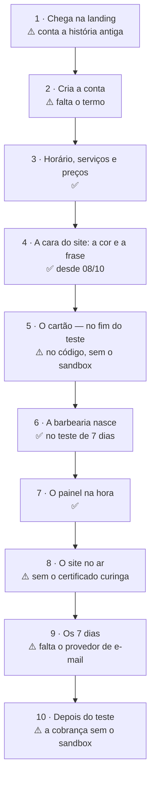

# Jornada do barbeiro — da landing ao painel e ao site no ar

> Escrito em 27/09/2026. **Roteiro para construir** o autoatendimento decidido em 24/09
> (`PLANO-PRODUTIZACAO.md` §13): o caminho que o dono de uma barbearia percorre sozinho,
> do anúncio até o site dele recebendo agendamento.
>
> Cada passo diz **o que ele vê**, **o que o sistema faz**, **o que já existe** no código —
> conferido arquivo por arquivo nesta data, referências `arquivo:linha` literais —, **o que
> falta** e **o que pode dar errado**.
>
> Status: **desenho, implementado em parte.** Dos dez passos, quatro funcionam e seis existem
> pela metade; nenhum falta de todo. Contados em 10/10/2026, com o cartão no código — mas sem a
> prova no sandbox da Asaas, por isso pela metade. Em 08/10 eram quatro, cinco e um; em 27/09,
> três, três e quatro. O que funciona está fechado atrás de `CADASTRO_ABERTO=1`; nada disto
> está aberto em produção.
>
> Companheiros: `PENDENCIAS-ABERTAS.md` §6 (a ordem de trabalho, que o §5 abaixo detalha),
> `PENDENCIAS-ABERTAS.md` §4.14 (o teste e a cobrança), `ARQUITETURA-COBRANCA-V1.md` (a
> Asaas) e `FLUXO-COMPLETO.md` (o caminho antigo, com montagem, que este substitui quando
> estiver pronto).
>
> ⚠️ **08/10/2026: seis decisões mudaram este desenho** (`PLANO-PRODUTIZACAO.md` §13): um
> layout com a cor do dono; o cartão no fim do teste, não no cadastro; a cobrança como módulo
> do app; e-mail para a senha e os avisos; 3 dias de carência; só plano mensal. **O cadastro
> novo e o teste de 7 dias foram feitos no mesmo dia**, e com eles reescritos os passos 2, 4,
> 6, 7, 8, 9 e 10. ~~O passo 5 — o cartão —, o §3 e o §5 ainda descrevem o desenho anterior:
> são reescritos junto com o código da cobrança~~ — o passo 5 foi reescrito em 10/10, com o
> código; o §3 fica como registro, e o §5 ganhou o que foi feito.

**Legenda:** ✅ existe e foi visto funcionando · ⚠️ existe pela metade · ❌ não existe

---

## 1. O caminho inteiro

| Passo | O que é | Hoje |
|---|---|---|
| 1 | Chega na landing e aperta o botão | ⚠️ o botão principal leva ao WhatsApp |
| 2 | Cria a conta: nome, endereço do site, WhatsApp, e-mail, senha | ⚠️ existe; falta o termo aceito |
| 3 | Horário, serviços e preços | ✅ |
| 4 | Escolhe a cor e a frase do topo, vendo a prévia | ✅ desde 08/10 — um layout só, por decisão |
| 5 | Cadastra o cartão | ⚠️ desde 10/10, no fim do teste, pela tela de assinatura — no código, sem a prova no sandbox (`PENDENCIAS-ABERTAS.md` §4.14) |
| 6 | A barbearia é criada | ✅ no teste, com a data de fim gravada, desde 08/10 |
| 7 | Entra no painel | ✅ já logado, desde 25/09 |
| 8 | O site vai ao ar | ⚠️ a tela de fim confere o endereço antes de dizer "no ar", desde 10/10; falta o certificado curinga |
| 9 | Os 7 dias grátis | ⚠️ a contagem no painel existe desde 08/10, e o aviso por e-mail desde 09/10 — falta o provedor de envio |
| 10 | A primeira cobrança, e o que vem depois | ⚠️ a carência e o site fora do ar desde 08/10; a cobrança e o cancelar desde 10/10, sem a prova no sandbox |

**O que já dá para mostrar hoje, de ponta a ponta,** na sua máquina, com
`CADASTRO_ABERTO=1` nos dois aplicativos e `DOMINIO_BASE=localhost:4321` no da barbearia:
o botão "Criar a minha agora" da landing leva ao `/cadastrar`, e dali saem o painel já
logado, a galeria e o site em `<endereço>.localhost:4321`, agendando. Do `/cadastrar` em
diante, é o caminho conferido ao vivo em 25/09/2026 com o build de produção
(`ESTADO-ATUAL.md` §8). O que não dá para mostrar é tudo que envolve dinheiro, layout e
prazo.

---

## 2. Passo a passo

### 2.1 Passo 1 — Ele chega na landing

**O que ele vê.** A página de vendas: o que recebe, o preço e um botão.

**Hoje:**

- Os botões que vendem — o do cabeçalho, o do topo e o do preço — abrem o **WhatsApp**
  (`apps/vendas/src/pages/index.astro:7-8`, usados em `index.astro:68`, `index.astro:100`
  e `index.astro:275`). O de cadastro, "Criar a minha agora", só aparece com
  `CADASTRO_ABERTO` (`index.astro:117`), e de propósito como terceiro botão
  (`index.astro:109-116`).
- A página inteira conta a montagem: *"sem você montar nada"*, *"eu monto inteira"*
  (`PENDENCIAS-ABERTAS.md` §4.15).
- O cartão de preço diz *"cancela quando quiser, avisando 30 dias"* (`index.astro:250`),
  promete *"Endereço próprio com o nome da sua barbearia"* (`index.astro:252`) e vende o
  plano *"Anual, à vista"* (`index.astro:262`).

**O que falta:**

- O botão principal vira **"Começar os 7 dias grátis"**, levando ao `/cadastrar`.
- **Embaixo do botão, antes de ele gastar cinco minutos no formulário:** *"Pede cartão de
  crédito. Nada é cobrado antes do 8º dia."* É o aviso que evita o pior caso — preencher
  tudo e descobrir no fim que precisa de um cartão que ele não tem.
- A reescrita da tese (`PENDENCIAS-ABERTAS.md` §4.15), por último, quando o resto existir.

**O que pode dar errado:**

- **"Avisando 30 dias" e "7 dias grátis" não se combinam sozinhos.** Se ele cancelar no 6º
  dia, precisa não pagar nada; depois de pagar, o aviso de 30 dias pode significar mais
  uma cobrança. Os dois têm que estar ditos do mesmo jeito na landing, no cadastro e no
  termo (`PENDENCIAS-ABERTAS.md` §1.2).
- **"Endereço próprio"** lê-se como domínio dele. No autoatendimento ele recebe
  `endereco.<domínio do produto>`; o domínio próprio é opcional e pago à parte
  (`PENDENCIAS-ABERTAS.md` §0, decisão de 01/09).
- **O plano anual à vista não cabe** num teste de 7 dias com cartão sem uma decisão — ver
  o §4, abaixo.

### 2.2 Passo 2 — Ele cria a conta

**O que ele vê.** O `/cadastrar`, com a marca do produto e não a da barbearia, que ainda não
existe (`apps/barbearia/src/pages/cadastrar.astro:40-47`). Embaixo do título, *"No fim, o seu
site já está no ar — com os seus serviços e a sua cor."* (`cadastrar.astro:179`). Até 08/10
era *"Leva dois minutos"*, que deixou de ser verdade com o bloco da marca maior. Uma página
só, em cinco blocos (`cadastrar.astro:184-289`):

- **A barbearia:** nome, **endereço do site** com a prévia de como vai ficar, rua, cidade.
- **Você:** o nome dele, **o WhatsApp** — que é o login e o contato do site ao mesmo tempo
  (`cadastrar.astro:206`) —, **o e-mail**, obrigatório desde 08/10 (`cadastrar.astro:210`),
  e a senha.
- **Sua marca:** a frase do topo e a cor, com a prévia do topo do site — o passo 4 —, o
  Instagram e *"Como você descreveria a sua barbearia?"*. Tudo opcional.
- **Horário** e **serviços com preço** — o passo 3.

**O que o sistema faz, hoje:**

| Conferência | Onde |
|---|---|
| A tela responde 404 sem a chave | `apps/barbearia/src/pages/cadastrar.astro:28` |
| No máximo 5 cadastros por hora por endereço de rede | `apps/barbearia/src/pages/api/cadastrar.ts:91` |
| Só aceita JSON — página de outro site não cria conta nem loga ninguém | `apps/barbearia/src/pages/api/cadastrar.ts:102` |
| O endereço tem que servir de subdomínio | `apps/barbearia/src/lib/provisionarBarbearia.ts:236` |
| **O endereço não pode ser reservado** — `painel`, `admin`, `www`, `api`, o nome do produto e outros, 39 ao todo; desde 08/10 | `apps/barbearia/src/lib/provisionarBarbearia.ts:245`, com a lista e o porquê de cada grupo em `apps/barbearia/src/lib/enderecosReservados.ts` |
| O endereço não pode estar tomado | `apps/barbearia/src/lib/provisionarBarbearia.ts:282` |
| O WhatsApp não pode ser o login de outro barbeiro, em barbearia nenhuma | `apps/barbearia/src/lib/provisionarBarbearia.ts:287` |
| **O e-mail é obrigatório pela web** e tem que ter forma de e-mail; grava em minúsculas; desde 08/10 | `apps/barbearia/src/pages/api/cadastrar.ts:81` e `apps/barbearia/src/lib/provisionarBarbearia.ts:252-255` |

**O que falta:**

- **O termo de uso e a privacidade, aceitos aqui**, com a versão aceita gravada junto da
  barbearia (`PENDENCIAS-ABERTAS.md` §1.2). Sem ninguém no caminho, esta tela é o único
  lugar onde ele lê o combinado — inclusive quando o cartão vai ser cobrado.
- ~~**Endereços reservados**~~ — ✅ feito em 08/10/2026, na tabela acima
  (`PENDENCIAS-ABERTAS.md` §4.16).
- **Dizer que o endereço é para sempre.** O painel não tem como trocá-lo — a rota que grava
  a configuração, `api/admin/settings.ts`, não mexe em endereço nenhum —, e trocar quebraria
  todo link já compartilhado.

**O que pode dar errado:**

- ~~**A senha criada às pressas é a que ele esquece.** Não existe "esqueci minha senha"~~ — ✅
  existe desde 09/10/2026: o link no login manda a senha nova ao e-mail do cadastro
  (`PENDENCIAS-ABERTAS.md` §4.17). Quem não tem e-mail — a equipe, e o dono do Bayron —
  continua dependendo de alguém: o barbeiro, do dono, pela tela da equipe; o dono, de você,
  pelo `scripts/set-admin-password.mjs`, com a regra manual de lá. ⚠️ E, em produção, nada sai
  até existir o provedor de envio.
- **Um WhatsApp para duas coisas.** Quem entra com o número pessoal e quer o da loja no
  site não tem como separar. O provisionador aceita um segundo número (`telefoneDono`,
  `apps/barbearia/src/lib/provisionarBarbearia.ts:53`), mas nem a tela nem a rota do
  cadastro o recebem (`apps/barbearia/src/pages/api/cadastrar.ts:62-82`).
- ~~**Não pedimos e-mail**~~ — ✅ pedimos desde 08/10/2026, e desde 09/10 ele é usado: a
  senha nova, os avisos e o e-mail de boas-vindas (`PENDENCIAS-ABERTAS.md` §4.17).
- **E-mail digitado errado continua difícil de perceber.** A forma é conferida, a existência
  não: `ze@gmial.com` passa. Desde 09/10 há duas pistas — o e-mail de boas-vindas, que não
  chega, e o e-mail à vista no painel, na tela da equipe e na de assinatura, onde se corrige.
  A confirmação por link, recomendada aqui antes, não foi feita (`PENDENCIAS-ABERTAS.md` §4.17).

### 2.3 Passo 3 — Horário, serviços e preços

**O que ele vê.** Os dias da semana com abre-e-fecha, e oito serviços comuns já listados
— corte, degradê, barba, corte + barba, pezinho, infantil, sobrancelha, pigmentação —
esperando o preço dele (`apps/barbearia/src/lib/catalogoSugerido.ts:57`).

**Hoje: ✅.** O que ficar sem preço entra desligado: nenhum "R$ 0,00" vai para o ar
(`apps/barbearia/src/pages/cadastrar.astro:8-16`). E o horário não é enfeite: é dele que
saem as vagas do site.

**O que pode dar errado:**

- ~~**Todos os preços em branco** = o botão "Reservar horário" leva a uma tela em branco~~ —
  ✅ consertado em 09/10/2026: a tela oferece o WhatsApp da barbearia
  (`PENDENCIAS-ABERTAS.md` §4.9). O site continua nascendo sem agendamento pelo site — o
  cadastro avisa, mas deixa passar.
- ~~**Os centavos somem**~~ — ✅ consertado em 27/09/2026: R$ 39,90 aparece R$ 39,90 no site,
  no agendamento e no painel, e editar o nome não mexe mais no preço
  (`PENDENCIAS-ABERTAS.md` §2.15).
- ~~**Barbearia de um barbeiro só** obriga o cliente a escolher barbeiro~~ — ✅ consertado em
  09/10/2026: com um barbeiro só, o agendamento tem três passos (`PENDENCIAS-ABERTAS.md` §2.2).

### 2.4 Passo 4 — A cara do site: a cor e a frase do topo

> **Decidido em 27/09/2026:** a escolha acontece **aqui, no cadastro, antes do cartão** —
> o site já nasce com a cara que ele escolheu. Rejeitado: escolher no painel, depois de
> entrar; o cadastro ficaria mais curto, mas o site nasceria no padrão e dependeria de ele
> lembrar de trocar.
>
> **Decidido em 08/10/2026: um layout, e a cor do dono** (`PLANO-PRODUTIZACAO.md` §13 e
> `PENDENCIAS-ABERTAS.md` §4.13). As três miniaturas de layout que este passo descrevia
> saíram do lançamento. E o cartão não vem mais logo depois: foi para o fim do teste.

**O que ele vê.** No bloco "Sua marca" (`apps/barbearia/src/pages/cadastrar.astro:219-253`):
a frase do topo; oito cores prontas e uma "outra", livre
(`apps/barbearia/src/lib/coresDoCadastro.ts:18-27`); e embaixo, **a prévia do topo do site
dele** — o nome, a frase e o botão "Agendar horário" na cor escolhida, sobre o fundo do site
(`cadastrar.astro:235-243`). Sem frase, a prévia mostra o nome, que é o que o site mostra.

**Hoje: ✅, desde 08/10/2026.**

- A cor passa pela mesma derivação do painel (`lib/accent.ts`), no navegador e no servidor.
  Clara demais para o texto branco do botão, o site usa o mesmo tom mais escuro; cinza,
  preto ou branco — sem tom para preservar —, fica a cor padrão. Nos dois casos a prévia
  mostra o resultado e diz por quê, antes de gravar (`cadastrar.astro:313-336`).
- As oito prontas passam no contraste sem ajuste, e nenhuma é a cor padrão — que o medidor
  do painel não conta. As duas regras têm teste (`tests/cores-do-cadastro.test.ts`): a
  primeira versão da lista tinha o "Petróleo" igual à padrão, e quem o escolhesse ouviria do
  painel que faltava escolher a cor.
- A frase vai para a `tagline` da configuração, até 200 caracteres
  (`apps/barbearia/src/lib/provisionarBarbearia.ts:257-260`). Foi a recomendação de 27/09
  para este passo: é a primeira coisa que o visitante lê, e o medidor a cobra com 15 pontos
  (`apps/barbearia/src/lib/completude.ts:127`).
- Sem escolher cor, o site nasce com a padrão, e o medidor cobra depois.

**O efeito no painel**, pela conta do medidor (pesos em `completude.ts:111-162`,
arredondamento em `completude.ts:185`):

| O que ele preencheu no cadastro | O painel abre em |
|---|---|
| Só o obrigatório | 14%: só o horário conta, 15 dos 110 pontos |
| O obrigatório, o Instagram e o texto sobre | 32% |
| Com a cor e a frase do topo, sem o Instagram e o texto sobre | 36% |
| Com a cor, a frase, o Instagram e o texto sobre | 55% |

O layout não vale ponto; a cor só vale se não for a padrão (`completude.ts:143`).

~~**Falta decidir** (`PENDENCIAS-ABERTAS.md` §4.13): quantas cores, e se o fundo é dele ou do
layout~~ — decidido em 08/10/2026: **uma** cor, e o fundo é o do layout.

**O que pode dar errado:**

- ~~**Miniatura bonita com foto de banco de imagem**~~ — sem objeto desde 08/10: não há
  miniatura, e a prévia mostra o topo como ele fica no primeiro dia, sem foto.
- **A prévia é só o topo.** Ele escolhe a cor vendo o nome, a frase e um botão; o resto do
  site — os serviços, o rodapé, a galeria quando houver — ele só vê depois de criar.
- **A "outra" cor depende do seletor do aparelho.** O `<input type="color">` abre a paleta do
  sistema, diferente no Android, no iPhone e no computador. Não foi visto num celular de
  verdade — só no navegador da nuvem, em tamanho de celular.
- **Uma página só, com cinco blocos, é longa no celular.** A promessa de tempo saiu em 08/10;
  dividir em telas, com o progresso à vista, não foi feito.

### 2.5 Passo 5 — O cartão

**O que ele vê, desde 10/10/2026 — no código, sem a prova no sandbox.** O cartão não é pedido
no cadastro: a decisão de 08/10 o levou para o fim do teste. A faixa do painel conta os dias e
leva à tela de assinatura, onde o botão *"Cadastrar o cartão"* vem com a data dita antes —
*"A primeira mensalidade é cobrada em DD/MM; até lá, nada é cobrado."* —, e dali à página de
pagamento da Asaas, onde ele digita o cartão. A volta é para a mesma tela: *"Cartão
cadastrado. A assinatura está em dia."* Se a confirmação da Asaas ainda não chegou, *"Recebemos
o seu cartão…"*, e a tela confere de novo sozinha; saiu sem pagar, *"Nada foi cobrado."*
(`apps/barbearia/src/pages/admin/assinatura.astro`; as regras, em `src/lib/cobranca.ts`).

**Hoje: ⚠️** — o código existe e foi provado contra uma Asaas de mentira que segue a
documentação; a de verdade, não (`PENDENCIAS-ABERTAS.md` §4.14). A chave do sandbox existe
desde 10/10; a conta de produção depende do CNPJ (`ARQUITETURA-COBRANCA-V1.md` §11).

*O desenho de 27/09, com o cartão no cadastro — superado em 08/10:* antes de sair da tela, em
letra de tamanho normal:

> Hoje você não paga nada. Em **<data do 8º dia>** cobramos **R$ 100** no cartão.
> Cancele antes, pelo painel, e não paga nada.

Depois, a **página de pagamento da Asaas**, onde ele digita o cartão. E a volta para o
produto.

**Como fazer, conferido na documentação da Asaas em 27/09/2026** (docs.asaas.com —
*Checkout Asaas*, *Criar novo checkout* e *Tokenização de cartão de crédito*; **não
testado em sandbox**):

- O **Checkout** é uma página hospedada pela Asaas, com cartão, e aceita cobrança
  recorrente (`chargeTypes: RECURRENT`, com o bloco `subscription`).
- A primeira cobrança pode ficar para uma data futura (`nextDueDate`) — são os 7 dias.
- Ela avisa por webhook (`CHECKOUT_PAID`, `CHECKOUT_CANCELED`, `CHECKOUT_EXPIRED`) e devolve
  o pagador para o produto (`callback`). A própria documentação avisa que as URLs de volta
  *"não substituem a confirmação assíncrona por Webhook"*.
- **O número do cartão nunca passa pelo seu servidor**, que é a exigência de
  `PENDENCIAS-ABERTAS.md` §4.14. **A tokenização não serve para isso**, ao contrário do que
  aquela seção supunha: ela é uma chamada à API (`POST /v3/creditCard/tokenizeCreditCard`)
  com os dados do cartão, feita com a chave de API da conta — que não pode ir para o
  navegador. A página dela não oferece componente de navegador nem trata do assunto. Sobra
  o Checkout.

~~**Hoje: ❌** — nenhuma linha de código, e **nenhuma conta na Asaas**~~ — em 27/09. A conta
PJ exige CNPJ; se você não tem, verificar se a conta PF atende (`ARQUITETURA-COBRANCA-V1.md` §11).

**O que o sandbox tem que responder antes de qualquer tela** — a documentação não diz. *As
telas vieram antes, em 10/10, por escolha sua; as perguntas continuam, com as que o código
assumiu, no `PENDENCIAS-ABERTAS.md` §4.14:*

1. **Que evento chega no dia do cadastro, se nada é cobrado nele.** O `CHECKOUT_PAID` pode
   vir só no 8º dia, junto com a cobrança — e aí o passo 6 fica sem gatilho. O desenho do
   §3.1, abaixo, depende desta resposta.
2. **Se o cartão é validado no cadastro.** Sem cobrança nem pré-autorização, o cartão
   inválido ou sem limite só aparece no 8º dia — com o site no ar há uma semana.
3. **Quais dados a página pede ao titular** (CPF, CEP, telefone, e-mail). A Asaas exige CPF
   ou CNPJ (`PENDENCIAS-ABERTAS.md` §4.14): se a página não pedir, o cadastro pede. A
   documentação diz que dá para preencher previamente os dados do cliente.

~~**O que falta, além disso:** o webhook com idempotência desde o primeiro cliente
(`ARQUITETURA-COBRANCA-V1.md` §5.1); a cobrança fixada à vista, sem parcelamento
(`ARQUITETURA-COBRANCA-V1.md` §4); e as duas decisões de desenho do §3, abaixo~~ — os dois
primeiros no código em 10/10 (`ARQUITETURA-COBRANCA-V1.md` §5.3); as decisões, tomadas em 08/10.

**O que pode dar errado:**

- **Quem não tem cartão de crédito desiste aqui.** Parte do alvo — barbearia sem sistema,
  controlada no caderno — não tem cartão no nome do negócio (`PLANO-PRODUTIZACAO.md` §13,
  custo 7). O aviso do passo 1 diminui a frustração; não aumenta o número de cartões.
- **Ele volta do Checkout antes de o webhook chegar.** A volta, sozinha, não prova nada —
  qualquer um digita o endereço de retorno. ✅ *Desde 10/10, a volta só informa: quem põe a
  barbearia em dia é o webhook, e a tela confere de novo sozinha, até 15 vezes.*
- ~~**Ele fecha a aba no meio.** Fica uma barbearia sem cartão ocupando o endereço (§3.1,
  abaixo)~~ — sem objeto desde 08/10: a barbearia já existe, no teste; fechar a aba só deixa o
  cartão para depois.
- **Ele abre dois Checkouts e paga no primeiro** — clicou duas vezes, ou voltou e clicou de
  novo. ✅ *Achado no ensaio de 10/10 e tratado: a barbearia guarda os últimos 20, e o
  pagamento de qualquer um deles a acha.*
- **A Asaas foi escolhida pelo Pix** (`PENDENCIAS-ABERTAS.md` §0, 30/08), e o cadastro não
  usa Pix. No cartão a diferença para a Stripe encolhe, mas a Asaas continua mais barata
  (`ARQUITETURA-COBRANCA-V1.md` §4 — tarifas de 28/08, a reconferir antes de lançar).

### 2.6 Passo 6 — A barbearia nasce

**O que o sistema faz, hoje: ✅**, numa transação só
(`apps/barbearia/src/lib/provisionarBarbearia.ts:358-429`): a barbearia, a configuração com
a marca — a cor e a frase do topo inclusive —, o dono como administrador, com o e-mail, o
expediente, os serviços e o vínculo de cada serviço com o dono. Depois, o endereço entra no
ar na hora — o cache de endereços é recarregado
(`apps/barbearia/src/pages/api/cadastrar.ts:125`) em vez de esperar até 30 segundos
(`apps/barbearia/src/lib/tenant.ts:72`).

**Nasce no teste, desde 08/10/2026:** status `trial`, com o fim do teste gravado — a
meia-noite que começa o 8º dia depois do cadastro, no fuso da barbearia
(`fimDoTeste`, em `apps/barbearia/src/lib/situacao.ts`). A migration 0007 deu ao banco os
estados `trial` e `past_due`, as duas datas que começam os prazos (`trial_ends_at` e
`past_due_since`) e as travas que recusam teste sem data de fim. O script de linha de comando
ainda cria sem teste, com `--sem-teste`, para barbearia combinada por fora; a web, nunca.

~~**Com o desenho recomendado no §3.1, abaixo, isto muda de lugar**~~ — sem objeto desde
08/10: com o cartão no fim do teste, não existe `pending`, e a barbearia nasce no teste já no
cadastro.

~~**O que falta:** a barbearia nasce `active`, para sempre~~ — ✅ feito em 08/10/2026, acima.

### 2.7 Passo 7 — O painel na hora

**O que ele vê.** O fim da tela de fim do cadastro — a do passo 8, abaixo: o botão "Abrir o
meu painel" (`cadastrar.astro:496`) e o aviso de que já está dentro do painel e de que da
próxima vez entra com o WhatsApp, escrito do jeito que ele vai digitar, e a senha. Até 08/10
era só isso, sob o título *"Pronto. A sua barbearia existe."*

**Hoje: ✅**, desde 25/09/2026: o cadastro abre a sessão do dono novo e substitui qualquer
outra que houvesse no aparelho (`apps/barbearia/src/pages/api/cadastrar.ts:163`).

No painel, **o medidor de completude** diz o que falta, do mais pesado para o mais leve:
logo, texto sobre, frase do topo, capa, **fotos dos cortes**, cor, Instagram, avaliações do
Google, busca (`apps/barbearia/src/lib/completude.ts:111-162`). A galeria, a logo, a capa e
as fotos de produto se sobem ali mesmo (`PLANO-PRODUTIZACAO.md` §13, *Fotos*).

**O que falta:**

- ~~**A contagem do teste** no topo do painel~~ — ✅ desde 08/10, a faixa (passo 9).
- ~~**Um lugar para cancelar** (passo 10)~~ — ✅ desde 10/10, na tela de assinatura, sem a
  prova no sandbox.
- **Por onde ele volta amanhã.** O "Entrar" da landing (`index.astro:63`) leva ao
  `/acessar`, que pede o endereço do site e diz que o painel mora nele
  (`apps/vendas/src/pages/acessar.astro:31`) — o modelo de um painel por barbearia. Com o
  painel central, a tela vira um redirecionamento, ou some
  (`ARQUITETURA-MULTI-TENANT-V1.md` §8). E o *"Não lembra o endereço? Me chama no
  WhatsApp"* (`acessar.astro:76-78`) é suporte seu.

**O que pode dar errado:**

- **O painel abre em 14%** para quem preencheu só o obrigatório (a tabela do passo 4). Para
  quem acabou de atravessar um formulário longo, 14% soa como "falta quase tudo". Com a cor
  e a frase no cadastro, abre em 36%.
- No teste de 27/09/2026, na máquina do dono, abriu em **32%** — ele preencheu também o texto
  sobre e o Instagram. E a tela de Configurações dizia que a frase do topo era ignorada, quando
  é ela o título do site; consertado no mesmo dia (`PENDENCIAS-ABERTAS.md` §2.28).

### 2.8 Passo 8 — O site no ar

**O que ele vê.** ✅ *Desde 10/10/2026, só depois de conferir:* a tela pede ao endereço novo,
do navegador do dono, uma imagem que só o app serve — se ela carrega, o caminho inteiro
funciona: o DNS, o certificado, o proxy, o app e a barbearia achada pelo endereço. Aí, *"O seu
site está no ar."*, com os três botões. Enquanto não abre: *"O seu site está quase no ar."*, o
endereço em texto, **sem botão de divulgar**, o aviso para não divulgar ainda e um *"Conferir
agora"*; ela mesma confere a cada 20 segundos, por até 30 minutos
(`apps/barbearia/src/lib/noAr.ts`, `src/pages/api/no-ar.svg.ts`). O começo do cadastro também
deixou de prometer *"no ar"*, e o e-mail de boas-vindas também: o servidor não sabe.

*Até 10/10:* ao terminar o cadastro, *"O seu site está no ar."*, o
endereço, e três botões — abrir o site, mandar no WhatsApp com o texto pronto e copiar o
texto para a bio do Instagram. Embaixo, os próximos passos, cada um com o link que leva lá:
pôr preço num serviço (só quando nenhum tem), subir as fotos dos cortes, subir a logo e a
capa (`apps/barbearia/src/pages/cadastrar.astro:439-501`).

O endereço vem do resolvedor, não de uma conta feita à parte
(`apps/barbearia/src/pages/api/cadastrar.ts:132-133`): se ele não achar a barbearia pelo
endereço, o link daria 404, e a tela não mostra link nenhum. Sem `DOMINIO_BASE`, também não
— o título vira *"A sua barbearia existe."*, e a tela diz que o endereço aparece quando o
domínio estiver configurado.

**Hoje: ⚠️.**

- O site funciona para qualquer barbearia nova: seção sem conteúdo não aparece
  (`PENDENCIAS-ABERTAS.md` §4.1), a galeria aparece a partir de 3 fotos, e o agendamento
  grava — o defeito que o derrubava dentro da requisição foi consertado em 25/09
  (`PENDENCIAS-ABERTAS.md` §2.19).
- **Mas não existe endereço de verdade.** O domínio do produto não foi registrado, e o nome
  ainda é provisório: Fadeline, desde 08/10 (`PENDENCIAS-ABERTAS.md` §0.1). Sem `DOMINIO_BASE`, o
  sistema não inventa um endereço (`apps/barbearia/src/lib/tenant.ts:275`), e o painel
  esconde o "Ver meu site" (`apps/barbearia/src/layouts/AdminLayout.astro:132-136`).
- Para cada barbearia nova funcionar sem trabalho seu, falta o registro DNS curinga e o
  certificado emitido por endereço (`ARQUITETURA-COBRANCA-V1.md` §7.4).
- ✅ **Consertado em 27/09/2026, no primeiro teste na máquina do dono:** o botão de WhatsApp de
  toda barbearia nova chamava um número do Vietnã, porque o cadastro gravava o número sem o 55
  (`PENDENCIAS-ABERTAS.md` §2.25); e o link do site, mandado no WhatsApp, abria com a foto e o
  endereço do Bayron (`PENDENCIAS-ABERTAS.md` §2.26).

~~**O que falta:** a tela de fim do cadastro não mostra o site~~ — ✅ feita em 08/10/2026, a
descrita acima. Era o que este passo pedia desde 27/09: o momento em que ele mostra o produto
para alguém — e quem mostra, convence a si mesmo a pagar no 8º dia.

**O teste de 27/09/2026 confirmou a falta.** Quem terminou o cadastro esperava que ele pedisse
as fotos e os produtos. Pela decisão de 24/09 as fotos ficam no painel
(`PLANO-PRODUTIZACAO.md` §13), e isso continua certo — o problema é que o fim do cadastro não
leva a nada: painel em 32% e um site escuro, só com o nome. A mesma tela do "O seu site está no
ar" deve trazer os próximos passos — as fotos dos cortes, a capa, a cor e a frase do topo, cada
um com o botão que leva lá. Os produtos, não: nem toda barbearia vende. ✅ Feito em 08/10 —
sem a cor e a frase, que passaram a ser pedidas no próprio cadastro (passo 4).

**O que pode dar errado:**

- **O primeiro visitante vê um site sem foto nenhuma**, porque a barbearia nasce sem
  (`PLANO-PRODUTIZACAO.md` §13, custo 5).
- ~~**O endereço `painel` na mão de um estranho**~~ — ✅ consertado em 08/10/2026: o cadastro
  recusa os endereços reservados (`PENDENCIAS-ABERTAS.md` §4.16).
- ~~**"No ar" é o que o app sabe, não o que a internet vê.**~~ A tela afirmava *"O seu site
  está no ar"* quando o app achava a barbearia pelo endereço — sem saber se o registro DNS
  curinga e o certificado existiam (`ARQUITETURA-COBRANCA-V1.md` §7.4). ✅ *Consertado em
  10/10: confere antes, do navegador do dono.* **O que sobra:** ela confere a rede DELE — o
  cliente num celular, com o DNS ainda propagando na operadora, pode não abrir o que abriu no
  Wi-Fi da barbearia. E sem o certificado curinga, ela diz a verdade — *"quase no ar"* — para
  todo cadastro: abrir um endereço recém-criado de fora, num celular, continua no teste antes
  de abrir o cadastro.
- **"Mandar no WhatsApp" abre a escolha do contato**, não um contato: é o `wa.me/?text=`, sem
  número. No computador sem o WhatsApp instalado, abre o WhatsApp Web.
- ~~**A aba do navegador mostrava o ícone do Astro**~~ — o framework do site — em toda
  barbearia que não subiu o dela. ✅ Consertado em 27/09/2026: sem ícone enviado, a aba mostra
  a inicial da barbearia na cor dela, no site e no painel
  (`apps/barbearia/src/lib/iconeDaAba.ts`).

### 2.9 Passo 9 — Os 7 dias

**Hoje: ⚠️**, desde 08/10/2026.

- **A contagem existe.** Toda tela do painel tem a faixa do teste — *"Teste grátis: faltam
  7 dias, até 15/10."* —, que vira alerta na véspera e no último dia, com o botão para a tela
  de assinatura (o texto em `apps/barbearia/src/lib/assinatura.ts`; a faixa no
  `AdminLayout.astro`). O fim do cadastro já diz a data — *"7 dias grátis, até 15/10."* —, e
  a tela `/admin/assinatura` diz o prazo, o preço e o que acontece depois.
- **O aviso fora do painel existe desde 09/10/2026**, por e-mail: 2 dias antes do fim do
  teste, quando ele acaba e quando o site sai do ar — um de cada, e só o da fase de agora
  (`apps/barbearia/src/lib/avisos.ts`). ⚠️ Em produção, só sai depois de existir o provedor de
  envio (`PENDENCIAS-ABERTAS.md` §4.17).
- ~~**Um aviso antes da primeira cobrança**~~ — mudou de forma em 08/10: com o cartão no fim
  do teste, o aviso que importa é o do fim do teste e o da carência.

**O que pode dar errado:** ~~a cobrança que ele não lembrava de ter autorizado~~ — sem
objeto desde 08/10: ninguém é cobrado sem ter cadastrado o cartão depois de usar. O risco
virou o contrário: **o dono que gostou, não abriu o painel e só descobre que o site saiu do
ar quando um cliente reclama.** Até o provedor de e-mail existir, a faixa é o único aviso; depois, o e-mail — que ele pode
não abrir.

### 2.10 Passo 10 — A primeira cobrança, e o que vem depois

**Desde 08/10/2026**, o cartão é cadastrado antes do fim do teste, na tela de assinatura, e a
cobrança mensal começa no fim do teste; o webhook da Asaas confirma e a barbearia sai de
`trial` e fica `active`. ~~⚠️ **Nada disso existe ainda**~~ — **no código desde 10/10/2026,
sem a prova no sandbox** (`PENDENCIAS-ABERTAS.md` §4.14). Sem as variáveis `ASAAS_*`, o botão
continua desligado, com *"Ainda não dá para pagar por aqui"*.

**Hoje: ⚠️.** O que não depende da Asaas está feito; o resto é decisão ou código:

| Situação | Hoje |
|---|---|
| **O teste acaba sem cartão** | ✅ desde 08/10: 3 dias inteiros de carência, com o site no ar e a faixa do painel em alerta; depois, fora do ar (`apps/barbearia/src/lib/situacao.ts`). Teste até 15/10: carência até 18/10, fora do ar no dia 19 |
| **O cartão recusa** | ✅ a mesma regra (`PENDENCIAS-ABERTAS.md` §1.3) — e, desde 10/10, o webhook grava `past_due` na primeira falha, sem a prova no sandbox. O botão vira *"Atualizar o cartão"* |
| **Fora do ar** | ✅ desde 08/10: o site responde 503 com *"O agendamento online está temporariamente indisponível"*, o nome e o WhatsApp da barbearia, sem falar em dívida (`apps/barbearia/src/lib/siteForaDoAr.ts`). O painel abre só a tela de assinatura, sem a navegação e com os próximos horários para consulta; o login leva até ela. Pagou, volta — em até 30 segundos, o tempo do cache de barbearias. Dar 404 continua descartado (`PENDENCIAS-ABERTAS.md` §3.5) |
| **Ele quer cancelar** | ⚠️ desde 10/10, *"Cancelar a assinatura"* na tela de assinatura, com confirmação: a Asaas para de cobrar e o site fica no ar até o fim do mês pago — com a cobrança atrasada, só o que restava da carência. Assinando de novo, volta. As regras, decididas na implementação, foram confirmadas em 10/10 — e sair do ar pela cobrança não cancela: o pagamento que passar traz o site de volta. Falta o termo dizer (`PENDENCIAS-ABERTAS.md` §4.14 e `PENDENCIAS-ABERTAS.md` §1.2) |
| **Esqueceu a senha** | ✅ desde 09/10: "Esqueci minha senha" no login, com o link no e-mail do cadastro; quem não tem e-mail depende do dono ou de você (`PENDENCIAS-ABERTAS.md` §4.17) |
| **Quer a nota fiscal** | Não tratado em desenho nenhum (`ARQUITETURA-COBRANCA-V1.md` §11) |
| **Quer levar os clientes embora** | A exportação (`PENDENCIAS-ABERTAS.md` §3.6) — é resposta de contrato também |
| **Testou e não pagou** | O que fazer com os dados dos clientes dele — e com o endereço, que a barbearia fora do ar segura para sempre (`PENDENCIAS-ABERTAS.md` §1.2) |

**O que pode dar errado, no que já existe:**

- **A barbearia fora do ar segura o endereço para sempre.** Sem a regra de quanto tempo
  guardar (`PENDENCIAS-ABERTAS.md` §1.2), cada teste abandonado é um endereço a menos e dado de
  cliente guardado sem contrato.
- **O cliente da barbearia não desmarca pelo site enquanto ela estiver fora do ar** — o link
  `/a/…` também mostra o aviso. O WhatsApp da barbearia, no aviso, é o caminho.
- **O barbeiro da equipe** vê a tela de assinatura com os horários dele e não cadastra o
  cartão. Esse filtro não tem teste automático — só o caminho do dono foi conferido.

---

## 3. As duas decisões que o passo 5 força

### 3.1 O cartão antes ou depois de a barbearia existir

> ⚠️ **Superado em 08/10/2026:** o cartão foi para o fim do teste (`PLANO-PRODUTIZACAO.md`
> §13), e a barbearia nasce `trial` no cadastro — feito no mesmo dia (passo 6). Não existe
> `pending` nem a limpeza das pendentes. O resto desta seção é o desenho anterior, mantido
> como registro.

**A. Cria a barbearia como `pending`, e só então manda ao cartão.** O webhook da Asaas a
passa para `trial`, com a data de fim gravada. Quem desiste no cartão deixa uma barbearia
pendente ocupando o endereço — então uma limpeza apaga as pendentes com mais de 24 horas e
devolve o endereço.

**B. Guarda o formulário à parte e só cria a barbearia depois do cartão.** Nada de
barbearia fantasma; em troca, o endereço escolhido não fica reservado enquanto ele paga, e
passa a existir um segundo lugar que sabe o que uma barbearia precisa para nascer.

**Recomendo A.** O provisionamento de hoje fica quase como está — só nasce `pending` em vez
de `active` —, o Checkout recebe o número da barbearia como referência, e a regra continua
morando num lugar só. Dois lugares que sabem criar uma barbearia divergem em silêncio: foi
por isso que o `/cadastrar` e o script de linha de comando passaram a usar a mesma função
(`apps/barbearia/src/lib/provisionarBarbearia.ts:4-11`).

O que A exige — é a costura que o `PENDENCIAS-ABERTAS.md` §4.14 diz que ninguém desenhou:

| Estado | O site | O painel |
|---|---|---|
| `pending` | fora do ar | só a tela "falta o cartão", com o botão de voltar ao Checkout |
| `trial` | no ar | inteiro, com a contagem dos dias |
| `active` | no ar | inteiro |
| `suspended` | a página do motivo | só a tela de regularizar |

~~⚠️ **Hoje o resolvedor só serve barbearia `active`**~~ — ✅ desde 08/10/2026 ele serve pela
fase, não pelo status: no teste e na carência, o site está no ar
(`apps/barbearia/src/lib/tenant.ts:196`, nas linhas 201 e 205), e `tests/teste-gratis.test.ts`
confere as oito combinações de status e prazo.

⚠️ **A pendente prende o próprio dono.** O WhatsApp de login é único no mundo
(`provisionarBarbearia.ts:287-295`): quem fecha a aba do Checkout e tenta se cadastrar de novo
uma hora depois ouve *"Este WhatsApp já é o login de outro barbeiro"* — sobre o cadastro
dele mesmo. O `/cadastrar` precisa reconhecer esse caso e mandá-lo entrar e terminar, em
vez de recusar.

⚠️ **A depende da primeira pergunta do sandbox** (passo 5): se nenhum evento chegar no dia
do cadastro, não há o que passe a barbearia de `pending` para `trial`.

### 3.2 Onde mora o código da cobrança

O `ARQUITETURA-COBRANCA-V1.md` §2 decidiu, em 28/08, e o cabeçalho de lá reafirmou em 24/09:
**a barbearia nunca sabe que dinheiro existe** — cobrança num aplicativo separado, e
rejeitada a tabela de assinatura no banco da barbearia. Das três razões de lá, a que continua
de pé é a segunda: *se a cobrança quebrar, as barbearias continuam funcionando.* As outras
duas eram do tempo de um container por barbearia — "N instâncias", "15 volumes"; hoje o app
é um só, num lugar só.

| | Vantagem | Custo |
|---|---|---|
| **Aplicativo separado** (o desenho de 28/08) | Uma falha na cobrança não encosta na agenda | Mais um deploy, mais variáveis, mais um processo para vigiar — e duas fontes de verdade para costurar: a data de fim mora num banco, o pagamento no outro |
| **Módulo isolado dentro do app da barbearia** | Um deploy só; o webhook muda o status direto | Reverte a decisão de 28/08; exige um guarda para nenhuma tela de barbearia importar a cobrança |

**Minha recomendação: o módulo.** Para a meta de 10 clientes, o segundo aplicativo custa mais
do que protege, e a proteção que importa — a razão 2 — sai de um webhook mínimo: grava o
evento cru, responde 200 e processa depois, o padrão do `ARQUITETURA-COBRANCA-V1.md` §5.1.
**Mas é reversão de decisão sua**, e só vale registrada no `ARQUITETURA-COBRANCA-V1.md` §2,
com o motivo. Até lá, vale o de lá.

---

## 4. O que só você decide

Em ordem de quando trava:

| Decisão | Trava o passo | Minha recomendação |
|---|---|---|
| O termo de uso, com a cláusula da cobrança e a do cancelamento (`PENDENCIAS-ABERTAS.md` §1.2) | 2 | Advogado, uma vez |
| Quantas cores, e se o fundo é dele (`PENDENCIAS-ABERTAS.md` §4.13) | 4 | Uma cor, fundo do layout: é o que a garantia de contraste de hoje já cobre |
| O cartão antes ou depois da barbearia (§3.1, acima; registrado em `PENDENCIAS-ABERTAS.md` §4.14) | 5 | Antes: nasce `pending` |
| Onde mora a cobrança (§3.2, acima; registrado em `PENDENCIAS-ABERTAS.md` §4.14) | 5 | O módulo, registrando a reversão |
| ~~Como ele recupera a senha, e se o cadastro pede e-mail~~ — ✅ e-mail, decidido em 08/10 e feito em 09/10 (`PENDENCIAS-ABERTAS.md` §4.17) | 2 e 10 | Um canal só para a senha e para o aviso de cobrança |
| O plano anual à vista no autoatendimento (`PENDENCIAS-ABERTAS.md` §4.15) | 1 e 5 | Tirar da primeira versão: começa mensal, e o anual vira oferta dentro do painel depois do 8º dia |
| O 8º dia sem pagamento (`PENDENCIAS-ABERTAS.md` §1.3) | 10 | — |
| ~~O canal do aviso antes de cobrar~~ — ✅ o e-mail, feito em 09/10 (`PENDENCIAS-ABERTAS.md` §1.3) | 9 | O mesmo da recuperação de senha |
| O nome e o domínio (`PENDENCIAS-ABERTAS.md` §0) | 8 | Antes de abrir o cadastro: o endereço aparece para o dono no primeiro minuto |

---

## 5. A ordem de construção

É a onda 2 do `PENDENCIAS-ABERTAS.md` §6 — *antes de abrir o cadastro público* —, vista pelo
caminho do barbeiro. Muda uma coisa lá e encaixa o que a jornada achou sem lugar:

- **Muda:** a prova no sandbox da Asaas passa a vir antes de tudo (item 0). É o único ponto
  que pode desmentir o desenho: se o Checkout não fizer o que a documentação diz, os passos
  5 e 6 mudam — e é melhor saber antes de existir código para jogar fora. É pouco trabalho,
  e abrir a conta não depende de código: se exigir CNPJ, é prazo que corre por fora
  (`ARQUITETURA-COBRANCA-V1.md` §11) — melhor começar já.
- **Encaixa:** a recuperação de senha (`PENDENCIAS-ABERTAS.md` §4.17), a contagem do teste e
  o cancelar no painel, o aviso antes de cobrar e o `/acessar`.

0. **A conta na Asaas e a prova no sandbox**: as três perguntas do passo 5, a volta e o
   webhook.
1. ~~**Os pequenos que já mordem hoje:** os centavos, o combo em qualquer dia, a semana do
   painel, o login só com JSON e o resumo do combo~~ — ✅ os centavos em 27/09, o resto em
   09/10 (`PENDENCIAS-ABERTAS.md` §6, item 1).
2. ~~**O que todo cadastro encontra no primeiro minuto:** a tela de agendar vazia e o passo
   inútil do barbeiro único~~ — ✅ 09/10 (`PENDENCIAS-ABERTAS.md` §4.9 e
   `PENDENCIAS-ABERTAS.md` §2.2). ~~**No lugar, o CSRF entre subdomínios**~~
   (`PENDENCIAS-ABERTAS.md` §2.30) — ✅ fechado no mesmo dia.
3. ~~**Endereços reservados**~~ (✅ 08/10) **e um jeito de tirar do ar**
   (`PENDENCIAS-ABERTAS.md` §4.16).
4. ~~**O passo 4:** os três layouts, a cor e a frase do topo no cadastro, que vira telas
   (`PENDENCIAS-ABERTAS.md` §4.13)~~ — ✅ 08/10, com um layout só: a cor e a frase com a
   prévia, e a tela de fim do passo 8. A divisão em telas ficou de fora.
5. **O teste, a cobrança e a suspensão** (`PENDENCIAS-ABERTAS.md` §4.14 e
   `PENDENCIAS-ABERTAS.md` §3.5): os estados `pending` e `trial`, o resolvedor servindo
   `trial`, o Checkout, o webhook idempotente, a limpeza das pendentes, a página do motivo —
   e, no painel, a contagem e o cancelar. ✅ **Feitos em 08/10/2026:** o `trial` com a data
   de fim, o resolvedor servindo pela fase, a carência, o site fora do ar e, no painel, a
   contagem e a tela de assinatura. ~~**Faltam** o Checkout, o webhook idempotente e o
   cancelar~~ — no código em 10/10/2026, sem a prova no sandbox, que era o item 0
   (`PENDENCIAS-ABERTAS.md` §4.14). `pending` e a limpeza das pendentes saíram: com o cartão
   no fim do teste, elas não existem.
   - ~~**5b. A recuperação de senha e o aviso antes de cobrar**, que usam o mesmo canal~~ —
     ✅ 09/10, pelo e-mail; falta o provedor de envio (`PENDENCIAS-ABERTAS.md` §4.17 e
     `PENDENCIAS-ABERTAS.md` §1.3).
6. **A landing, o `/acessar` e a aposentadoria do `/onboarding` e do `/envios`**
   (`PENDENCIAS-ABERTAS.md` §4.15) — por último de propósito: ela descreve o produto pronto.
7. ~~**A página "Como fica"** (`PENDENCIAS-ABERTAS.md` §4.10) — mostra os três layouts, então
   vem depois deles~~ — ✅ 09/10, com os prints de uma barbearia fictícia.

Fora do código, e travando a abertura do mesmo jeito: **o termo aceito no cadastro**, com a
versão gravada, quando o advogado entregar (`PENDENCIAS-ABERTAS.md` §1.2); a política de
suporte escrita na tela (`PENDENCIAS-ABERTAS.md` §1.4); e **o domínio, o DNS curinga e os
certificados** (`ARQUITETURA-COBRANCA-V1.md` §7.4), que dependem do nome.

---

## 6. O que muda nos outros documentos

**Mudou em 27/09/2026, junto com este roteiro** — só registros e avisos:

- `PLANO-PRODUTIZACAO.md` §13 — o item 3 da decisão ganhou *quando* a escolha acontece.
- `PENDENCIAS-ABERTAS.md` — a linha de 27/09 na tabela do `PENDENCIAS-ABERTAS.md` §0, notas
  no `PENDENCIAS-ABERTAS.md` §4.13, no `PENDENCIAS-ABERTAS.md` §4.14 e no
  `PENDENCIAS-ABERTAS.md` §4.15, o item novo `PENDENCIAS-ABERTAS.md` §4.17, e na onda 2 do
  `PENDENCIAS-ABERTAS.md` §6 o item 0 e o resto da jornada encaixado nos itens de lá.
- `ARQUITETURA-COBRANCA-V1.md` e `FLUXO-COMPLETO.md` — um aviso no cabeçalho apontando para
  cá. O `ESTADO-ATUAL.md` §8 ganhou a linha de 27/09; o índice `README.md`, a linha deste
  documento, e a do `FLUXO-COMPLETO.md` passou a apontar para cá.

**Mudou de novo em 27/09/2026, depois do primeiro teste na máquina do dono:** os passos
3, 7 e 8 ganharam o que foi consertado e o que o teste confirmou (`PENDENCIAS-ABERTAS.md` §2.15 e
`PENDENCIAS-ABERTAS.md` §2.25 a `PENDENCIAS-ABERTAS.md` §2.28), e o item 1 do §5 perdeu os
centavos.

**Mudou em 08/10/2026, com o cadastro novo:** os passos 2, 4, 7 e 8 e os itens 3 e 4 do §5,
acima; e, fora daqui, `PENDENCIAS-ABERTAS.md` §4.13, `PENDENCIAS-ABERTAS.md` §4.16,
`PENDENCIAS-ABERTAS.md` §4.17 e a onda 2 do `PENDENCIAS-ABERTAS.md` §6, a tabela *O que já
existe no código* do `PLANO-PRODUTIZACAO.md` §13 e a linha de 08/10 do `ESTADO-ATUAL.md` §8.

**Mudou de novo em 08/10/2026, com o teste de 7 dias:** os passos 6, 9 e 10, o aviso no
§3.1 e o item 5 do §5, acima; e, fora daqui, `PENDENCIAS-ABERTAS.md` §1.3,
`PENDENCIAS-ABERTAS.md` §3.5, `PENDENCIAS-ABERTAS.md` §4.14 e a onda 2 do
`PENDENCIAS-ABERTAS.md` §6, o `PLANO-PRODUTIZACAO.md` §13, o `ARQUITETURA-COBRANCA-V1.md` §5.2,
o `ARQUITETURA-MULTI-TENANT-V1.md` §5.1 e o `ESTADO-ATUAL.md` §7 e o `ESTADO-ATUAL.md` §8.

**Mudou em 09/10/2026, com o e-mail:** os passos 2 e 9, a tabela do passo 10, as duas
decisões do e-mail no §4 e o item 5b do §5, acima; e, fora daqui, `PENDENCIAS-ABERTAS.md` §1.3,
`PENDENCIAS-ABERTAS.md` §2.13, `PENDENCIAS-ABERTAS.md` §4.17 e a onda 2 do
`PENDENCIAS-ABERTAS.md` §6, o `PLANO-PRODUTIZACAO.md` §13, o `ARQUITETURA-COBRANCA-V1.md` §5.2, o
`ROTEIRO-MIGRACAO-PRODUCAO.md` §3.1 e o `ESTADO-ATUAL.md` §7 e o `ESTADO-ATUAL.md` §8.

**Mudou em 10/10/2026, com a cobrança e a tela final que confere:** o status do cabeçalho, o
§1, os passos 5, 7, 8 e 10 e o item 5 do §5, acima; e, fora daqui, `PENDENCIAS-ABERTAS.md` §0,
`PENDENCIAS-ABERTAS.md` §2.31, `PENDENCIAS-ABERTAS.md` §3.8, `PENDENCIAS-ABERTAS.md` §4.14 e a
onda 2 do `PENDENCIAS-ABERTAS.md` §6, o `ARQUITETURA-COBRANCA-V1.md` §5.2, o
`ARQUITETURA-COBRANCA-V1.md` §5.3 e o `ARQUITETURA-COBRANCA-V1.md` §7.4, e o `ESTADO-ATUAL.md`
§7 e o `ESTADO-ATUAL.md` §8.

**Muda quando for decidido ou implementado — não antes:**

- ~~`ARQUITETURA-COBRANCA-V1.md` §2, se a cobrança virar módulo (§3.2, acima)~~ — feito em
  08/10/2026, com a decisão.
- ~~`ARQUITETURA-COBRANCA-V1.md` §5.2 — os estados de lá, que não têm teste grátis~~ — feito
  em 08/10/2026, com o teste de 7 dias.
- `ARQUITETURA-MULTI-TENANT-V1.md` §8 — o `/acessar`, quando virar redirecionamento.
- `FLUXO-COMPLETO.md` — aposentado no dia em que o `/onboarding` sair.
